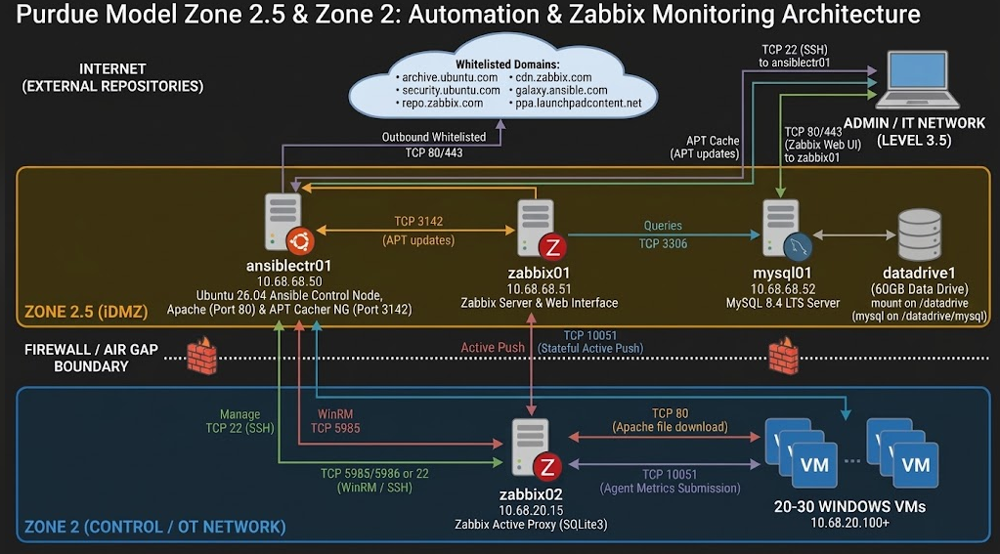
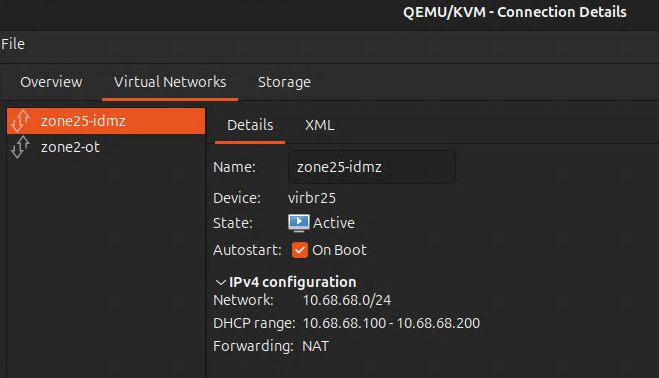
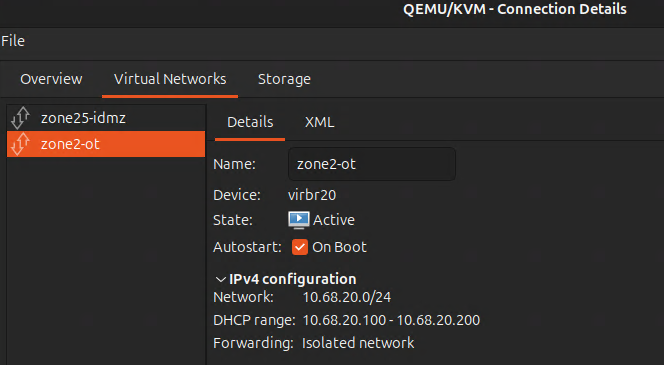
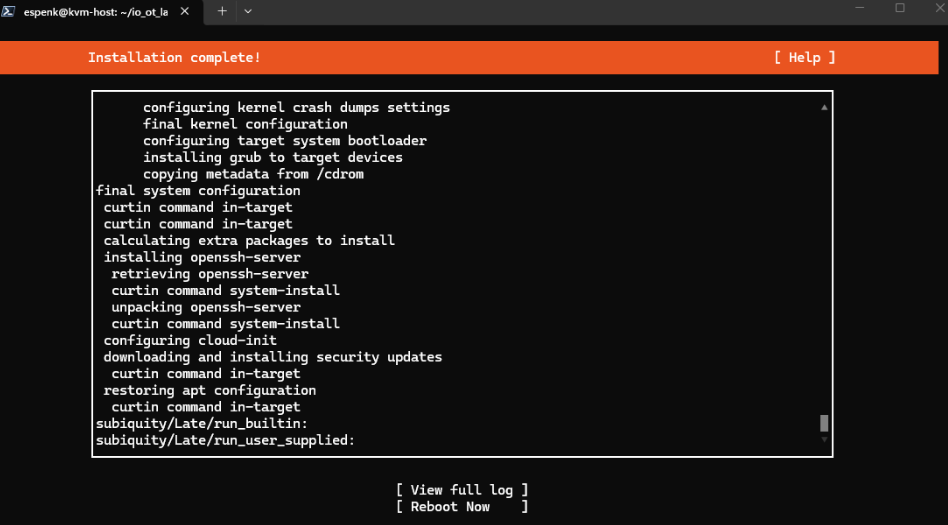
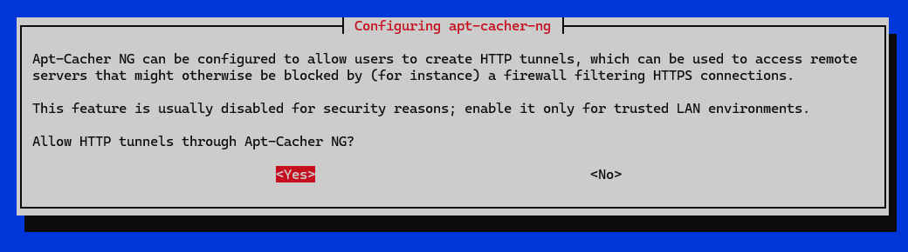
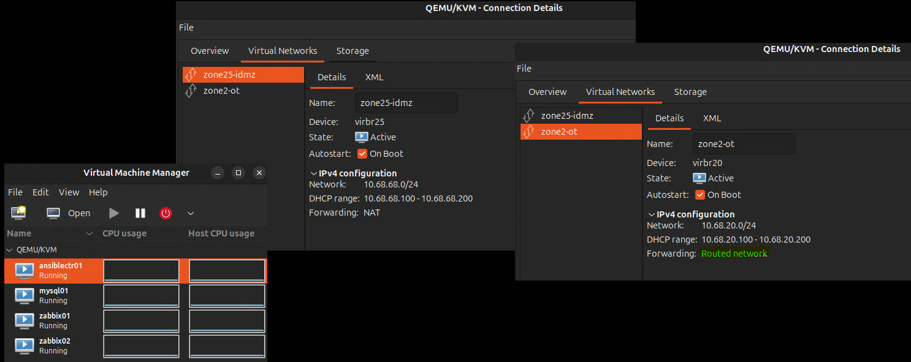
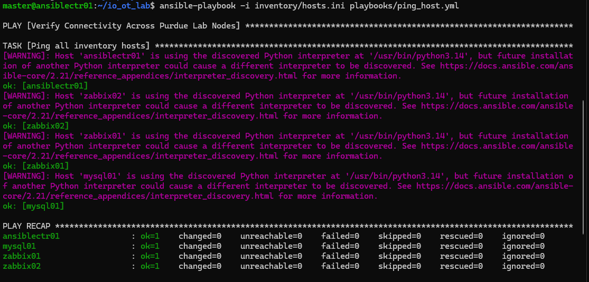
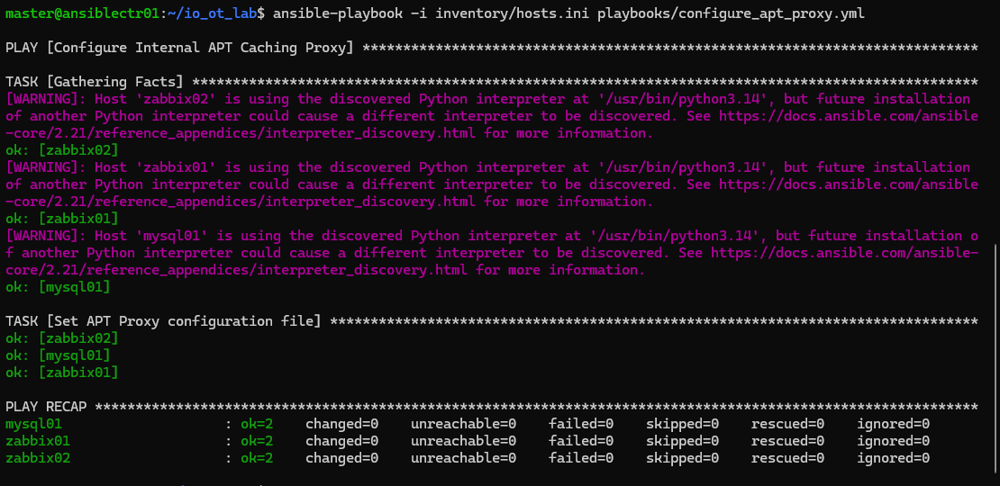

# Ansible IT/OT zabbix stack poc

Ansible is a radically simple IT automation platform that makes your applications and systems easier to deploy. Avoid writing scripts or custom code to deploy and update your applications— automate in a language that approaches plain English, using SSH, with no agents to install on remote systems.

## Table of content

- [Ansible IT/OT zabbix stack poc](#ansible-itot-zabbix-stack-poc)
  - [Table of content](#table-of-content)
- [Here's a quick guide to get you up to speed on Ansible](#heres-a-quick-guide-to-get-you-up-to-speed-on-ansible)
  - [Core Concepts](#core-concepts)
  - [Key Advantages](#key-advantages)
  - [Ansible Agentless Architecture Linux and Windows](#ansible-agentless-architecture-linux-and-windows)
- [Install Ansible on hostkvm-host-HP-ProDesk-600-G3-SFF Ubuntu 26.04](#install-ansible-on-hostkvm-host-hp-prodesk-600-g3-sff-ubuntu-2604)
  - [Getting started with Ansible](#getting-started-with-ansible)
- [Proof of Concept (PoC) Operational Runbook](#proof-of-concept-poc-operational-runbook)
  - [Topology](#topology)
  - [Team 1](#team-1)
  - [1. Environment and Tools Baseline](#1-environment-and-tools-baseline)
  - [1.1 Scenario \& Core Requirements Summary from research](#11-scenario--core-requirements-summary-from-research)
  - [2. Phase 1: Host Virtualization \& Isolated Network Configuration Team 1 starts](#2-phase-1-host-virtualization--isolated-network-configuration-team-1-starts)
    - [1. Zone 2.5 iDMZ Network Definition (zone25-idmz.xml)](#1-zone-25-idmz-network-definition-zone25-idmzxml)
    - [2. Zone 2 OT Control Network Definition (zone2-ot.xml)](#2-zone-2-ot-control-network-definition-zone2-otxml)
  - [3. Phase 2: Guest Image Staging and Volume Provisioning](#3-phase-2-guest-image-staging-and-volume-provisioning)
    - [Create disks](#create-disks)
    - [Deploy vms](#deploy-vms)
    - [Verify vms](#verify-vms)
    - [Use all full disk](#use-all-full-disk)
    - [View zones](#view-zones)
    - [Auto boot](#auto-boot)
    - [4 vms](#4-vms)
    - [Check kvm-host health](#check-kvm-host-health)
  - [4. Phase 3: Firewall Execution (team1)](#4-phase-3-firewall-execution-team1)
  - [5. Phase 4: Validation and Compliance Assurance (team 1)](#5-phase-4-validation-and-compliance-assurance-team-1)
- [Team 2 starts with ansiblectr01](#team-2-starts-with-ansiblectr01)
- [Run Proof of Concept (PoC) Operational Runbook with Ansible Team 2 starts](#run-proof-of-concept-poc-operational-runbook-with-ansible-team-2-starts)
  - [Phase 1: Bootstrap and Automation Execution](#phase-1-bootstrap-and-automation-execution)
    - [Step 1: Install Ansible on ansiblectr01](#step-1-install-ansible-on-ansiblectr01)
      - [Whitelisted repo](#whitelisted-repo)
    - [Step 2: Initialize Ansible Project \& Inventory Structure (~/ansible-idmz-ot) ansiblectr01](#step-2-initialize-ansible-project--inventory-structure-ansible-idmz-ot-ansiblectr01)
    - [Step 3: Generate \& Distribute SSH Keys across Managed Targets](#step-3-generate--distribute-ssh-keys-across-managed-targets)
      - [Production-grade standards, you should keep become = True, Privilege escalation](#production-grade-standards-you-should-keep-become--true-privilege-escalation)
    - [Step 4: Setup apt-cacher-ng \& Apache on ansiblectr01](#step-4-setup-apt-cacher-ng--apache-on-ansiblectr01)
    - [Step 5: Route APT Traffic on Managed Nodes via apt-cacher-ng playbook](#step-5-route-apt-traffic-on-managed-nodes-via-apt-cacher-ng-playbook)
      - [Clean Up Conflicting Remaps in acng.conf](#clean-up-conflicting-remaps-in-acngconf)
      - [Test Direct vs Proxied Fetch on zabbix02](#test-direct-vs-proxied-fetch-on-zabbix02)
      - [Verify and Enable Local Mirror Backends on ansiblectr01](#verify-and-enable-local-mirror-backends-on-ansiblectr01)
      - [Update playbook to last version](#update-playbook-to-last-version)
      - [Test manual sudo apt update](#test-manual-sudo-apt-update)
      - [This issue originates in Team 1's network zoning and inter-zone routing handoff step](#this-issue-originates-in-team-1s-network-zoning-and-inter-zone-routing-handoff-step)
      - [Architectural Flaw in zone2-ot.xml](#architectural-flaw-in-zone2-otxml)
      - [Corrected Libvirt Network Definition Script](#corrected-libvirt-network-definition-script)
      - [Summary: What Team 1 Needed to Change](#summary-what-team-1-needed-to-change)
      - [Verification of Inter-Zone Routing](#verification-of-inter-zone-routing)
      - [Verify apt-cacher-ng playbook](#verify-apt-cacher-ng-playbook)
    - [6.1 lab is fully up and running and correct static IP assignments, inter-zone routing via the KVM host bridge (responsible team 1)](#61-lab-is-fully-up-and-running-and-correct-static-ip-assignments-inter-zone-routing-via-the-kvm-host-bridge-responsible-team-1)
    - [6.1 How to Make Everything Persistent on the KVM Host (responsible team 1)](#61-how-to-make-everything-persistent-on-the-kvm-host-responsible-team-1)
  - [Now we can automate with Ansible and step 6 starts for team 2. But restart kvm-host first](#now-we-can-automate-with-ansible-and-step-6-starts-for-team-2-but-restart-kvm-host-first)
    - [Step 6 Verify current 2 playbooks on ansiblectr01](#step-6-verify-current-2-playbooks-on-ansiblectr01)
    - [Step 7: To Ensures /op\_ansible/automation.log exists with user input for tracking changes on hosts](#step-7-to-ensures-op_ansibleautomationlog-exists-with-user-input-for-tracking-changes-on-hosts)
    - [Step 8: Deploy MySQL 8.4 LTS on mysql01 playbooks](#step-8-deploy-mysql-84-lts-on-mysql01-playbooks)
    - [Step 9: Deploy Zabbix Server 7.0 LTS on zabbix01 playbooks](#step-9-deploy-zabbix-server-70-lts-on-zabbix01-playbooks)
    - [Step 10: Deploy Zabbix Active Proxy (SQLite3) on zabbix02 (Zone 2 OT) playbooks](#step-10-deploy-zabbix-active-proxy-sqlite3-on-zabbix02-zone-2-ot-playbooks)

# Here's a quick guide to get you up to speed on Ansible


## Core Concepts

* Control Node: The machine where Ansible is installed and commands are executed.

* Managed Nodes: The target servers, network devices, or VMs managed by Ansible.

* Inventory: A text file (INI or YAML) listing managed hosts grouped by environment or function.

* Playbook: A YAML file containing a sequence of plays and tasks that define the desired system state.

* Modules: Built-in Python scripts executed on targets to perform specific actions (e.g., package installation, file editing, service management).

* Roles: Modular, reusable directory structures for organizing playbooks, variables, and tasks.

## Key Advantages

* Agentless Architecture: Eliminates the need to maintain background daemons or agents on target systems.

* Declarative Language: Written in human-readable YAML focusing on what state the system should be in rather than how to achieve it.

* Idempotency: Tasks can run repeatedly without changing the system state if the desired outcome is already present.

## Ansible Agentless Architecture Linux and Windows

* On Linux, Ansible connects via SSH, authenticates using SSH keys or passwords, and transfers small Python modules to the /tmp directory on the target system. It executes those modules using the target's Python interpreter to apply the desired configuration, retrieves the JSON result, and automatically removes the temporary script files.

* On Windows, Ansible connects over WinRM (Windows Remote Management) or WinSSHD, authenticates using NTLM, Kerberos, or CredSSP, and executes PowerShell scripts or .NET code directly in memory. Results are captured in JSON format and returned to the control node without leaving persistent software behind.


# Install Ansible on hostkvm-host-HP-ProDesk-600-G3-SFF Ubuntu 26.04 

```bash
# install all
sudo apt update
sudo apt install software-properties-common
sudo add-apt-repository --yes --update ppa:ansible/ansible
sudo apt install ansible

# verify all
ansible --version

ansible [core 2.21.5]
  config file = /etc/ansible/ansible.cfg
  configured module search path = ['/home/espenk/.ansible/plugins/modules', '/usr/share/ansible/plugins/modules']
  ansible python module location = /usr/lib/python3/dist-packages/ansible
  ansible collection location = /home/espenk/.ansible/collections:/usr/share/ansible/collections
  executable location = /usr/bin/ansible
  python version = 3.14.4 (main, Aug 20 2026, 10:41:58) [GCC 15.2.0] (/usr/bin/python3)
  jinja version = 3.1.6
  pyyaml version = 6.0.3 (with libyaml v0.2.5)

```

Installing Ansible on Ubuntu

Ubuntu provides Ansible packages through a Personal Package Archive (PPA) that contains more recent versions than the standard repositories.

https://docs.ansible.com/projects/ansible/latest/installation_guide/installation_distros.html

## Getting started with Ansible

Do a new recap of the tutorial so you are up to speed.

This must be done before you start.

GOTO ansible/tutorial_ansible or use and build the quickguide as we walk. /ansible_quickguide.md


# Proof of Concept (PoC) Operational Runbook

## Topology



## Team 1


## 1. Environment and Tools Baseline

This PoC runs on an HP ProDesk 600 G3 SFF functioning as the virtualization node:

Physical Host: kvm-host-HP-ProDesk-600-G3-SFF

Operating System: Linux 7.0.0-42-generic #42-Ubuntu SMP PREEMPT_DYNAMIC (x86_64)

Processor: Intel(R) Core(TM) i7-6700 CPU @ 3.40GHz (8 vCPUs)

System Memory: 24 GB DDR4 RAM

Hypervisor Stack:

virsh (libvirt) version: 12.0.0

API version: QEMU 12.0.0

Hypervisor: QEMU 10.2.1

Internet Status: The physical host has no outbound firewall restrictions, allowing it to host and pull base images and tool dependencies. However, VM-level routing will enforce a single egress path on ansiblectr01 to ensure a realistic Purdue model simulation.


## 1.1 Scenario & Core Requirements Summary from research

Datacenter Handover: The datacenter build team manually provisions clean Ubuntu 26.04 and Windows Server VMs via GUI. Day-2 automation begins immediately after IP and credential handover.

1. Scenario & Core Requirements Summary
2. Why apt-cacher-ng Was Selected
3. Firewall Rule Matrix (Purdue / ISA-95 Architecture)

https://github.com/spawnmarvel/kvm-lab/blob/main/research_1_IT-OT_zabbix_stack/readme.md#1-scenario--core-requirements-summary

## 2. Phase 1: Host Virtualization & Isolated Network Configuration Team 1 starts

Before deploying the target stack, isolated virtual networks must be established on the physical host to separate the iDMZ (Zone 2.5) from the OT Control network (Zone 2) while designating ansiblectr01 as the sole gateway.

For Phase 1 network setup on kvm-host, here are the complete configuration files and execution commands to deploy both libvirt networks (zone25-idmz and zone2-ot) directly.

### 1. Zone 2.5 iDMZ Network Definition (zone25-idmz.xml)

This network enables NAT forwarding to allow ansiblectr01 outbound internet access while serving as the gateway for Zone 2.5 hosts.

```xml
<!-- Version: 1.0.0 -->
<!-- Description: Libvirt XML definition for Zone 2.5 iDMZ network with NAT forwarding -->
<network>
  <name>zone25-idmz</name>
  <forward mode='nat'/>
  <bridge name='virbr25' state='unknown'/>
  <ip address='10.68.68.1' netmask='255.255.255.0'>
    <dhcp>
      <range start='10.68.68.100' end='10.68.68.200'/>
    </dhcp>
  </ip>
</network>
```




### 2. Zone 2 OT Control Network Definition (zone2-ot.xml)

This network omits the <forward> tag entirely, creating a strictly isolated internal bridge to enforce air-gapped Purdue Zone 2 requirements.

```xml
<!-- Version: 1.0.0 -->
<!-- Description: Libvirt XML definition for Zone 2 OT network in isolated mode without host NAT -->
<network>
  <name>zone2-ot</name>
  <bridge name='virbr20' state='unknown'/>
  <ip address='10.68.20.1' netmask='255.255.255.0'>
    <dhcp>
      <range start='10.68.20.100' end='10.68.20.200'/>
    </dhcp>
  </ip>
</network>
```



```bash
ssh espenk@192.168.10.70
mkdir io_ot_lab_build
sudo nano create_network.sh
bash create_network.sh

```

Log

```log
Network zone25-idmz defined from zone25-idmz.xml

Network zone25-idmz started

Network zone25-idmz marked as autostarted

Network zone2-ot defined from zone2-ot.xml

Network zone2-ot started

Network zone2-ot marked as autostarted
```

List

```bash
sudo virsh net-list --all
Name          State    Autostart   Persistent
------------------------------------------------
zone2-ot      active   yes         yes
zone25-idmz   active   yes         yes
```

## 3. Phase 2: Guest Image Staging and Volume Provisioning

Deploy the VM disk files and provision the secondary 30 GB disk volume datadrive1 designated for mysql01 database use, we do not mount it before day 2 with ansible.

Resource Allocation Summary

* ansiblectr01: 2 vCPU, 4 GB RAM (Zone 2.5 iDMZ)
* zabbix01: 2 vCPU, 3 GB RAM (Zone 2.5 iDMZ)
* mysql01: 2 vCPU, 3 GB RAM (Zone 2.5 iDMZ)
* zabbix02: 2 vCPU, 3 GB RAM (Zone 2 OT Proxy)


### Create disks

```bash
sudo nano create_disks.sh
bash create_disks.sh
Formatting '/mnt/datadrive1/qemu/images/ansiblectr01.qcow2', fmt=qcow2 cluster_size=65536 extended_l2=off compression_type=zlib size=21474836480 lazy_refcounts=off refcount_bits=16
Formatting '/mnt/datadrive1/qemu/images/zabbix01.qcow2', fmt=qcow2 cluster_size=65536 extended_l2=off compression_type=zlib size=21474836480 lazy_refcounts=off refcount_bits=16
Formatting '/mnt/datadrive1/qemu/images/mysql01.qcow2', fmt=qcow2 cluster_size=65536 extended_l2=off compression_type=zlib size=21474836480 lazy_refcounts=off refcount_bits=16
Formatting '/mnt/datadrive1/qemu/images/zabbix02.qcow2', fmt=qcow2 cluster_size=65536 extended_l2=off compression_type=zlib size=21474836480 lazy_refcounts=off refcount_bits=16
Formatting '/mnt/datadrive1/qemu/images/mysql01-datadrive1.qcow2', fmt=qcow2 cluster_size=65536 extended_l2=off compression_type=zlib size=32212254720 lazy_refcounts=off refcount_bits=16
```

List iso

```bash
sudo virsh pool-list --all
Name              State    Autostart
---------------------------------------
boot              active   yes
datadrive1-pool   active   yes
default           active   yes

for pool in $(sudo virsh pool-list --all --name | grep -v '^$'); do
    echo "=== Storage Pool: ${pool} ==="
    sudo virsh vol-list "${pool}"
done
```

Log

```console
=== Storage Pool: boot ===
 Name   Path
--------------

=== Storage Pool: datadrive1-pool ===
 Name                           Path
------------------------------------------------------------------------------
 iso                            /mnt/datadrive1/iso
 lost+found                     /mnt/datadrive1/lost+found
 SERVER_EVAL_x64FRE_en-us.iso   /mnt/datadrive1/SERVER_EVAL_x64FRE_en-us.iso
 vms                            /mnt/datadrive1/vms

=== Storage Pool: default ===
 Name                      Path
----------------------------------------------------------------------------
 debian-12-netinst.iso     /var/lib/libvirt/images/debian-12-netinst.iso
 ubuntu-26.04-server.iso   /var/lib/libvirt/images/ubuntu-26.04-server.iso
```

### Deploy vms

| Hostname       | Network     | IP Address  | MAC Address       | Memory / vCPU | Primary / Secondary Storage                            |
| -------------- | ----------- | ----------- | ----------------- | ------------- | ------------------------------------------------------ |
| `ansiblectr01` | zone25-idmz | 10.68.68.10 | 52:54:00:68:68:10 | 4 GB / 2 vCPU | ansiblectr01.qcow2 (20GB)                              |
| `zabbix01`     | zone25-idmz | 10.68.68.50 | 52:54:00:68:68:50 | 3 GB / 2 vCPU | zabbix01.qcow2 (20GB)                                  |
| `mysql01`      | zone25-idmz | 10.68.68.52 | 52:54:00:68:68:52 | 3 GB / 2 vCPU | mysql01.qcow2 (20GB) + mysql01-datadrive1.qcow2 (30GB) |
| `zabbix02`     | zone2-ot    | 10.68.20.15 | 52:54:00:68:20:15 | 3 GB / 2 vCPU | zabbix02.qcow2 (20GB)                                  |

* 1 GB: $1 x 1024 = 1024 MB
* 2 GB: $2 x 1024 = 2048 MB
* 3 GB: $3 x 1024 = 3072 MB
* 4 GB: $4 x 1024 = 4096 MB


```bash

sudo nano create_vms_static_ansiblectr01.sh
bash create_vms_static_ansiblectr01.sh

ssh master@10.68.68.10
# master@ansiblectr01:~$

sudo nano create_vms_static_zabbix01.sh
bash create_vms_static_zabbix01.sh

ssh master@10.68.68.50
# master@zabbix01:~$

sudo nano create_vms_static_mysql01.sh
bash create_vms_static_mysql01.sh

# The standard solution is to install Ubuntu with only the primary OS disk attached, 
# verify SSH access, and then attach the secondary 30 GB volume to the domain.

# Attach Secondary Data Disk to Domain, Attach the 30 GB volume to mysql01 as persistent virtual target vdb:
# Version: 1.0.0
# Description: Attaches secondary 30GB qcow2 volume to running mysql01 instance and updates libvirt XML configuration
sudo virsh attach-disk mysql01 /mnt/datadrive1/qemu/images/mysql01-datadrive1.qcow2 vdb --config --live --subdriver qcow2

Disk attached successfully

ssh master@10.68.68.52
#master@mysql01:~$

# Running lsblk inside mysql01 via SSH shows /dev/vda (20G) and /dev/vdb (30G).
lsblk
NAME                      MAJ:MIN RM  SIZE RO TYPE MOUNTPOINTS
sr0                        11:0    1 1024M  1 rom
vda                       253:0    0   20G  0 disk
├─vda1                    253:1    0    1M  0 part
├─vda2                    253:2    0  1.8G  0 part /boot
└─vda3                    253:3    0 18.2G  0 part
  └─ubuntu--vg-ubuntu--lv 252:0    0   10G  0 lvm  /
vdb                       253:16   0   30G  0 disk

sudo nano create_vms_static_zabbix02.sh
bash create_vms_static_zabbix02.sh

ssh master@10.68.20.15

```

5 minutes per VM is a very accurate estimate for stepping through the interactive Ubuntu Server installer over the serial console.

VM 1 (10.68.68.10 — Zone 2.5 iDMZ): 💥
* Your server's name: ansiblectr01
* Pick a username: master, justfortest

VM 2 (10.68.68.50 — Zone 2.5 iDMZ): 💥
* Your server's name: zabbix01
* Pick a username: master, justfortest

VM 3 (10.68.68.52 — Zone 2.5 iDMZ): 💥
* Your server's name: mysql01
Pick a username: master, justfortest

VM 4 (10.68.20.15 — Zone 2 OT): 💥
* Your server's name: zabbix02
* Pick a username: master, justfortest

### Verify vms

```bash
sudo virsh list
Id   Name           State
------------------------------
2    ansiblectr01   running
4    zabbix01       running
6    mysql01        running

```




### Use all full disk


```bash

ssh master@10.68.68.10
# master@ansiblectr01:~$

sudo lvextend -l +100%FREE /dev/ubuntu-vg/ubuntu-lv -r
df -h /
Filesystem                         Size  Used Avail Use% Mounted on
/dev/mapper/ubuntu--vg-ubuntu--lv   18G  4.9G   13G  29% /

ssh master@10.68.68.50
# master@zabbix01:~$

sudo lvextend -l +100%FREE /dev/ubuntu-vg/ubuntu-lv -r
df -h /
Filesystem                         Size  Used Avail Use% Mounted on
/dev/mapper/ubuntu--vg-ubuntu--lv   18G  4.9G   13G  29% /

ssh master@10.68.68.52
#master@mysql01:~$

sudo lvextend -l +100%FREE /dev/ubuntu-vg/ubuntu-lv -r
df -h /
Filesystem                         Size  Used Avail Use% Mounted on
/dev/mapper/ubuntu--vg-ubuntu--lv   18G  4.9G   13G  29% 

ssh master@10.68.20.15
# master@zabbix02:~$
sudo lvextend -l +100%FREE /dev/ubuntu-vg/ubuntu-lv -r
df -h /
Filesystem                         Size  Used Avail Use% Mounted on
/dev/mapper/ubuntu--vg-ubuntu--lv   18G  4.5G   13G  27% /

```

### View zones

```bash

# Version: 1.0.0
# Description: Checks active DHCP lease status for ansiblectr01 on zone25-idmz
sudo virsh net-dhcp-leases zone25-idmz
Expiry Time           MAC address         Protocol   IP address       Hostname       Client ID or DUID
------------------------------------------------------------------------------------------------------------------------------------------------
2026-11-03 10:11:58   52:54:00:68:68:10   ipv4       10.68.68.10/24   ansiblectr01   ff:56:50:4d:98:00:02:00:00:ab:11:20:72:90:ca:5c:97:66:1e
2026-11-03 10:11:56   52:54:00:68:68:50   ipv4       10.68.68.50/24   zabbix01       ff:56:50:4d:98:00:02:00:00:ab:11:96:a3:ef:6e:d9:63:3e:e1
2026-11-03 10:12:08   52:54:00:68:68:52   ipv4       10.68.68.52/24   mysql01        ff:56:50:4d:98:00:02:00:00:ab:11:29:c1:56:8b:ac:65:be:0f


sudo virsh net-dhcp-leases zone2-ot
Expiry Time           MAC address         Protocol   IP address       Hostname   Client ID or DUID
--------------------------------------------------------------------------------------------------------------------------------------------
2026-11-03 09:11:55   52:54:00:68:20:15   ipv4       10.68.20.15/24   zabbix02   ff:56:50:4d:98:00:02:00:00:ab:11:5a:12:e9:9d:3a:a0:68:ee

```

### Auto boot

```bash
# Version: 1.0.0
# Description: Restarts libvirt service and verifies network bridge states
sudo systemctl restart libvirtd
sudo virsh net-start zone25-idmz 2>/dev/null || true
sudo virsh net-start zone2-ot 2>/dev/null || true
sudo virsh net-list --all

```
Verification: Networks zone25-idmz and zone2-ot show Active: yes

```bash
# Version: 1.0.0
# Description: Configures libvirt autostart policy across all scenario VMs
sudo virsh autostart ansiblectr01
sudo virsh autostart zabbix01
sudo virsh autostart mysql01
sudo virsh autostart zabbix02
```

Verify vms
```bash
sudo virsh list
Id   Name           State
------------------------------
14   zabbix02       running
15   zabbix01       running
16   mysql01        running
19   ansiblectr01   running
```

### 4 vms


### Check kvm-host health


```bash
# Version: 1.0.0
# Description: Displays host memory usage and running QEMU process resource consumption
free -h
top -bn1 | head -n 20
               total        used        free      shared  buff/cache   available
Mem:            22Gi       6.1Gi       6.4Gi       259Mi        10Gi        16Gi
Swap:          4.0Gi       1.2Mi       4.0Gi
top - 09:33:50 up 3 days, 11 min,  2 users,  load average: 0.31, 0.34, 0.55
Tasks: 304 total,   1 running, 303 sleeping,   0 stopped,   0 zombie
%Cpu(s):  5.4 us,  6.5 sy,  0.0 ni, 88.0 id,  0.0 wa,  0.0 hi,  0.0 si,  0.0 st
MiB Mem :  23390.2 total,   6527.8 free,   6277.0 used,  11233.1 buff/cache
MiB Swap:   4096.0 total,   4094.8 free,      1.2 used.  17113.2 avail Mem

    PID USER      PR  NI    VIRT    RES    SHR S  %CPU  %MEM     TIME+ COMMAND
 139895 espenk    20   0   13376   5884   3820 R  16.7   0.0   0:00.03 top
   6615 polkitd   20   0  389812  13012   8364 S   8.3   0.1   0:10.26 polkitd
   8598 espenk     9 -11  126912  25120   9040 S   8.3   0.1   1:08.76 pipewire
      1 root      20   0   27260  16800  10128 S   0.0   0.1   0:20.83 systemd
      2 root      20   0       0      0      0 S   0.0   0.0   0:00.32 kthreadd
      3 root      20   0       0      0      0 S   0.0   0.0   0:00.00 pool_wo+
      4 root       0 -20       0      0      0 I   0.0   0.0   0:00.00 kworker+
      5 root       0 -20       0      0      0 I   0.0   0.0   0:00.00 kworker+
      6 root       0 -20       0      0      0 I   0.0   0.0   0:00.00 kworker+
      7 root       0 -20       0      0      0 I   0.0   0.0   0:00.00 kworker+
      8 root       0 -20       0      0      0 I   0.0   0.0   0:00.00 kworker+
     10 root       0 -20       0      0      0 I   0.0   0.0   0:00.00 kworker+
     13 root       0 -20       0      0      0 I   0.0   0.0   0:00.00 kworker+


# Version: 1.0.0
# Description: Summarizes vCPU and RAM allocations across all running domains
sudo virsh list --all
for vm in $(sudo virsh list --name --state-running); do
  echo "=== $vm ==="
  sudo virsh dominfo $vm | grep -E "(CPU\(s\)|Max memory|Used memory)"
done

 Id   Name           State
------------------------------
 14   zabbix02       running
 15   zabbix01       running
 16   mysql01        running
 19   ansiblectr01   running

=== zabbix02 ===
CPU(s):         2
Max memory:     3121152 KiB
Used memory:    3121152 KiB
=== zabbix01 ===
CPU(s):         2
Max memory:     3145728 KiB
Used memory:    3145728 KiB
=== mysql01 ===
CPU(s):         2
Max memory:     3145728 KiB
Used memory:    3145728 KiB
=== ansiblectr01 ===
CPU(s):         2
Max memory:     4194304 KiB
Used memory:    4194304 KiB

# Version: 1.0.0
# Description: Displays filesystem storage usage for host root and data drive mounts
df -h / /mnt/datadrive1
Filesystem      Size  Used Avail Use% Mounted on
/dev/nvme0n1p2  233G   24G  198G  11% /
/dev/sda1       458G   26G  409G   6% /mnt/datadrive1
```

| VM Name          | Assigned Cap (`balloon.current`) | Host RAM Consumed (`balloon.rss`) | Free RAM Inside Guest (`balloon.usable`) | Real Guest Active Use |
| :--------------- | :------------------------------- | :-------------------------------- | :--------------------------------------- | :-------------------- |
| **zabbix02**     | ~3.00 GiB                        | ~944 MiB (0.92 GiB)               | ~2.20 GiB                                | ~250 MiB              |
| **ansiblectr01** | ~4.00 GiB                        | ~1,197 MiB (1.17 GiB)             | ~3.20 GiB                                | ~250 MiB              |
| **zabbix01**     | ~3.00 GiB                        | ~1,433 MiB (1.40 GiB)             | ~2.20 GiB                                | ~250 MiB              |
| **mysql01**      | ~3.00 GiB                        | ~1,448 MiB (1.41 GiB)             | ~2.20 GiB                                | ~250 MiB              |


kvm-host is handling all four active virtual machines (ansiblectr01, zabbix01, mysql01, zabbix02) cleanly without any hardware bottlenecks or memory pressure.

| Resource                        | Parameter  | Host Physical Capacity | Total VM Allocation | Usable Headroom                     | Status            |
| :------------------------------ | :--------- | :--------------------- | :------------------ | :---------------------------------- | :---------------- |
| **System RAM**                  | Memory     | 22 GiB                 | 13.6 GiB (Max Cap)  | ~17.3 GiB Usable (incl. Buff/Cache) | Optimal (0% Swap) |
| **CPU Cores**                   | Processing | Physical Host CPU      | 8 vCPUs (2 per VM)  | >95% Idle Capacity                  | Optimal           |
| **Storage (`/mnt/datadrive1`)** | Disk       | 458 GiB                | ~26 GiB Active      | 409 GiB Available                   | Optimal           |
| **Host System Root (`/`)**      | Disk       | 233 GiB                | ~24 GiB Active      | 198 GiB Available                   | Optimal           |


## 4. Phase 3: Firewall Execution (team1)

As part of the initial infrastructure build, Team 1 must implement firewall filtering on kvm-host before handing over the environment to Team 2. This enforces the single-egress architecture (ansiblectr01) while keeping Zone 2 OT isolated.

With the target hosts running, ansiblectr01 acts as the single egress point to fetch dependencies and distribute updates internally.

* Single Egress Point (FW-01): Internet NAT/Forwarding is restricted strictly to ansiblectr01 (10.68.68.10).

* Air-Gapped Zone 2 OT (FW-06, FW-07, FW-10): zabbix02 (10.68.20.15) and Zone 2 OT targets cannot route out to the internet directly.

* Controlled Inter-Zone Access: Only approved management (SSH 22), repository caching (apt-cacher-ng 3142), web downloads (Apache 80), database queries (MySQL 3306), and active proxy metrics (Zabbix 10051) are permitted.


```bash
cd io_ot_lab/
sudo nano create_firewall.sh

bash create_firewall.sh
Applying Team 1 firewall policy...
Firewall policy successfully applied.

# Version: 1.0.0
# Description: Saves current iptables configuration to netfilter-persistent storage
sudo apt-get install -y iptables-persistent netfilter-persistent
sudo iptables-save | sudo tee /etc/iptables/rules.v4 > /dev/null
sudo systemctl enable netfilter-persistent


# Version: 1.0.0
# Description: Pre-seeds debconf and enables netfilter-persistent for active iptables rules
echo "iptables-persistent iptables-persistent/auto-save-v4 boolean true" | sudo debconf-set-selections
echo "iptables-persistent iptables-persistent/auto-save-v6 boolean true" | sudo debconf-set-selections
sudo NEEDRESTART_MODE=a DEBIAN_FRONTEND=noninteractive apt-get install -y iptables-persistent netfilter-persistent

sudo iptables-save | sudo tee /etc/iptables/rules.v4 > /dev/null
sudo systemctl enable netfilter-persistent

sudo systemctl is-enabled netfilter-persistent
enabled

# Version: 1.0.0
# Description: Tests firewall rejection of direct internet traffic on zabbix01
ssh master@10.68.68.50 "curl -I --connect-timeout 3 https://archive.ubuntu.com" || echo "PASS: zabbix01 internet blocked"
master@10.68.68.50's password:
  % Total    % Received % Xferd  Average Speed  Time    Time    Time   Current
                                 Dload  Upload  Total   Spent   Left   Speed
  0      0   0      0   0      0      0      0           00:02              0
curl: (28) Connection timed out after 3001 milliseconds
PASS: zabbix01 internet blocked
```

Team 1 runs these automated tests on kvm-host to verify compliance before notifying Team 2.

```bash
Team 1 runs these automated tests on kvm-host to verify compliance before notifying Team 2.


# Version: 1.0.0
# Description: Automated security compliance verification suite executed by Team 1

echo "=== Test 1: Confirm ansiblectr01 Egress (FW-01 Allowed) ==="
ssh master@10.68.68.10 "curl -I --connect-timeout 5 https://archive.ubuntu.com" && echo "PASS: ansiblectr01 internet egress active"
# Test 1 (ansiblectr01): PASS — Outbound internet egress active (HTTP/1.1 200 OK).

echo "=== Test 2: Confirm zabbix01 Internet Egress Blocked (FW-01 Blocked) ==="
ssh master@10.68.68.50 "curl -I --connect-timeout 3 https://archive.ubuntu.com" || echo "PASS: zabbix01 internet blocked"
# Test 2 (zabbix01): PASS — Outbound connection timed out (Direct internet blocked).

echo "=== Test 3: Confirm mysql01 Internet Egress Blocked (FW-01 Blocked) ==="
ssh master@10.68.68.52 "curl -I --connect-timeout 3 https://archive.ubuntu.com" || echo "PASS: mysql01 internet blocked"
# Test 3 (mysql01): PASS — Outbound connection timed out (Direct internet blocked).

echo "=== Test 4: Confirm Zone 2 OT zabbix02 Internet Egress Blocked (FW-01 Blocked) ==="
ssh master@10.68.20.15 "curl -I --connect-timeout 3 https://archive.ubuntu.com" || echo "PASS: zabbix02 OT internet blocked"
# Test 4 (zabbix02): PASS — Outbound DNS/connection failed (Zone 2 OT internet blocked).

echo "=== Test 5: Confirm SSH Management from ansiblectr01 (FW-02/FW-03 Allowed) ==="
ssh master@10.68.68.10 "ssh -o BatchMode=yes master@10.68.20.15 hostname" && echo "PASS: SSH reachability verified"
# Test 5 (ansiblectr01 -> zabbix02 SSH): FAILED (Host key verification failed)
# When ansiblectr01 attempts to connect to zabbix02 (10.68.20.15), its SSH client checks ~/.ssh/known_hosts. 
# Because the host key for 10.68.20.15 has not yet been accepted or saved inside ansiblectr01, 
# non-interactive SSH with BatchMode=yes rejects the unverified fingerprint and closes the connection.


```

When Team 2 sets up SSH and runs the Ansible setup (or key distribution script), Ansible handles host key checking via host_key_checking = False in ansible.cfg or automatically populates known_hosts during key distribution.

Since Team 1 has already verified that the firewall permits SSH traffic on TCP port 22 between ansiblectr01 and zabbix02 (it failed on host key verification, not connection timeout), Team 1's firewall compliance phase is complete!


## 5. Phase 4: Validation and Compliance Assurance (team 1)

Ensure the deployment meets your strict security goals before handing over the system for monitoring to team 2.

You are ready to officially hand over the environment to Team 2 to begin Phase 1: Bootstrap and Automation Execution.

# Team 2 starts with ansiblectr01


# Run Proof of Concept (PoC) Operational Runbook with Ansible Team 2 starts


## Phase 1: Bootstrap and Automation Execution

### Step 1: Install Ansible on ansiblectr01

Update Step 1 on ansiblectr01 to use the official Ansible PPA package installation as referenced in the Ansible Community Documentation:

* https://docs.ansible.com/projects/ansible/latest/installation_guide/installation_distros.html
  
```bash
# Version: 1.0.0
# Description: Installs Ansible package on the control node
ssh master@10.68.68.10

sudo apt update
sudo apt install -y software-properties-common
sudo add-apt-repository --yes --update ppa:ansible/ansible
sudo apt install -y ansible

ansible --version
ansible [core 2.21.5]
  config file = /etc/ansible/ansible.cfg
  configured module search path = ['/home/master/.ansible/plugins/modules', '/usr/share/ansible/plugins/modules']
  ansible python module location = /usr/lib/python3/dist-packages/ansible
  ansible collection location = /home/master/.ansible/collections:/usr/share/ansible/collections
  executable location = /usr/bin/ansible
  python version = 3.14.4 (main, Aug 20 2026, 10:41:58) [GCC 15.2.0] (/usr/bin/python3)
  jinja version = 3.1.6
  pyyaml version = 6.0.3 (with libyaml v0.2.5)


sudo apt update
sudo apt upgrade

```
#### Whitelisted repo

| Rule ID    | Source Host    | Source Zone     | Destination FQDN / Host                          | Destination Zone    | Protocol / Port | Purpose                                                            |
| :--------- | :------------- | :-------------- | :----------------------------------------------- | :------------------ | :-------------- | :----------------------------------------------------------------- |
| **FW-01a** | `ansiblectr01` | Zone 2.5 (iDMZ) | `archive.ubuntu.com`, `security.ubuntu.com`      | External / Internet | TCP 80, 443     | Ubuntu base OS packages, security patches, and system dependencies |
| **FW-01b** | `ansiblectr01` | Zone 2.5 (iDMZ) | `ppa.launchpadcontent.net`, `galaxy.ansible.com` | External / Internet | TCP 80, 443     | Ansible PPA repository and Ansible Galaxy collection access        |
| **FW-01c** | `ansiblectr01` | Zone 2.5 (iDMZ) | `repo.zabbix.com`                                | External / Internet | TCP 80, 443     | Zabbix official repository and package updates                     |

### Step 2: Initialize Ansible Project & Inventory Structure (~/ansible-idmz-ot) ansiblectr01

Create the workspace and inventory first so that Ansible has a valid configuration and inventory target map before any key distribution or ad-hoc ping checks occur.

```bash
ssh master@10.68.68.10

# Version: 1.0.0
# Description: Initializes project workspace, configuration, and Purdue model inventory
mkdir -p ~/ io_ot_lab/{inventory,playbooks,roles}
cd ~/io_ot_lab

```

make inventory

master@ansiblectr01:~/io_ot_lab$

```bash

# Write ansible.cfg
cat <<'EOF' > ansible.cfg
[defaults]
inventory = ./inventory/hosts.ini
remote_user = master
private_key_file = ~/.ssh/id_ed25519
host_key_checking = False
retry_files_enabled = False
stdout_callback = default

[privilege_escalation]
become = True
become_method = sudo
become_user = root
become_ask_pass = False
EOF

# Write inventory/hosts.ini
cat <<'EOF' > inventory/hosts.ini
[control_node]
ansiblectr01 ansible_host=10.68.68.10

[zone25_idmz]
zabbix01    ansible_host=10.68.68.50
mysql01     ansible_host=10.68.68.52

[zone2_ot]
zabbix02    ansible_host=10.68.20.15

[db_servers]
mysql01     ansible_host=10.68.68.52

[zabbix_servers]
zabbix01    ansible_host=10.68.68.50

[zabbix_proxies]
zabbix02    ansible_host=10.68.20.15

[purdue_lab:children]
control_node
zone25_idmz
zone2_ot
EOF
```

Verify

```bash
ls
ansible.cfg  inventory  playbooks  roles

ls -la inventory/hosts.ini ansible.cfg
-rw-rw-r-- 1 master master 285 Nov  3 09:57 ansible.cfg
-rw-rw-r-- 1 master master 409 Nov  3 09:57 inventory/hosts.ini
```

### Step 3: Generate & Distribute SSH Keys across Managed Targets

Run the following script on ansiblectr01 from your ~/io_ot_lab directory:

```bash


# Version: 1.0.0
# Description: Generates SSH key, populates known_hosts, and distributes public key to targets
cd ~/io_ot_lab

# Generate Ed25519 keypair if not already created
if [ ! -f ~/.ssh/id_ed25519 ]; then
  ssh-keygen -t ed25519 -C "ansiblectr01-master" -N "" -f ~/.ssh/id_ed25519
fi

# Clean and rescan fingerprints locally to avoid key verification prompts
rm -f ~/.ssh/known_hosts
ssh-keyscan -H 10.68.68.10 10.68.68.50 10.68.68.52 10.68.20.15 >> ~/.ssh/known_hosts
chmod 600 ~/.ssh/known_hosts

# Copy public key to all target nodes (Password: justfortest)
for target in 10.68.68.10 10.68.68.50 10.68.68.52 10.68.20.15; do
  ssh-copy-id -i ~/.ssh/id_ed25519.pub master@$target
done

```
Verify ping with playbook

```bash
/home/master/io_ot_lab

sudo nano playbooks/ping_host.yml

ansible-playbook -i inventory/hosts.ini playbooks/ping_host.yml

```

Log

```console
PLAY [Verify Connectivity Across Purdue Lab Nodes] *********************************************************************

TASK [Ping all inventory hosts] ****************************************************************************************
[WARNING]: Host 'ansiblectr01' is using the discovered Python interpreter at '/usr/bin/python3.14', but future installation of another Python interpreter could cause a different interpreter to be discovered. See https://docs.ansible.com/ansible-core/2.21/reference_appendices/interpreter_discovery.html for more information.
ok: [ansiblectr01]
[WARNING]: Host 'zabbix02' is using the discovered Python interpreter at '/usr/bin/python3.14', but future installation of another Python interpreter could cause a different interpreter to be discovered. See https://docs.ansible.com/ansible-core/2.21/reference_appendices/interpreter_discovery.html for more information.
ok: [zabbix02]
[WARNING]: Host 'zabbix01' is using the discovered Python interpreter at '/usr/bin/python3.14', but future installation of another Python interpreter could cause a different interpreter to be discovered. See https://docs.ansible.com/ansible-core/2.21/reference_appendices/interpreter_discovery.html for more information.
ok: [zabbix01]
[WARNING]: Host 'mysql01' is using the discovered Python interpreter at '/usr/bin/python3.14', but future installation of another Python interpreter could cause a different interpreter to be discovered. See https://docs.ansible.com/ansible-core/2.21/reference_appendices/interpreter_discovery.html for more information.
ok: [mysql01]

PLAY RECAP *************************************************************************************************************
ansiblectr01               : ok=1    changed=0    unreachable=0    failed=0    skipped=0    rescued=0    ignored=0
mysql01                    : ok=1    changed=0    unreachable=0    failed=0    skipped=0    rescued=0    ignored=0
zabbix01                   : ok=1    changed=0    unreachable=0    failed=0    skipped=0    rescued=0    ignored=0
zabbix02                   : ok=1    changed=0    unreachable=0    failed=0    skipped=0    rescued=0    ignored=0
```


#### Production-grade standards, you should keep become = True, Privilege escalation

To align your lab with production-grade standards, you should keep become = True in your ansible.cfg (so your deployment playbooks for MySQL, Zabbix, and APT proxies run correctly with root privileges) and configure passwordless sudo for the master user across all managed targets.


To align with your production-grade requirement of keeping become = True in ansible.cfg while avoiding interactive sudo password prompts during automated playbook runs, what is missing is configuring passwordless sudo (NOPASSWD) for the master user across all target nodes. Without this, any subsequent playbook task that invokes privilege escalation will fail due to missing sudo credentials.

```bash
# Description: Configures passwordless sudo non-interactively using sudo -S over SSH
for host in 10.68.68.10 10.68.68.50 10.68.68.52 10.68.20.15; do
  echo "Configuring sudoers on $host..."
  ssh master@$host "echo 'justfortest' | sudo -S sh -c \"echo 'master ALL=(ALL) NOPASSWD:ALL' > /etc/sudoers.d/master && chmod 440 /etc/sudoers.d/master\""
done
Configuring sudoers on 10.68.68.10...
[sudo: authenticate] Password:
Configuring sudoers on 10.68.68.50...
[sudo: authenticate] Password:
Configuring sudoers on 10.68.68.52...
[sudo: authenticate] Password:
Configuring sudoers on 10.68.20.15...
[sudo: authenticate] Password:

# check it
ansible purdue_lab -m shell -a "whoami"
```

log

```console

[WARNING]: Host 'ansiblectr01' is using the discovered Python interpreter at '/usr/bin/python3.14', but future installation of another Python interpreter could cause a different interpreter to be discovered. See https://docs.ansible.com/ansible-core/2.21/reference_appendices/interpreter_discovery.html for more information.
ansiblectr01 | CHANGED | rc=0 >>
root
[WARNING]: Host 'mysql01' is using the discovered Python interpreter at '/usr/bin/python3.14', but future installation of another Python interpreter could cause a different interpreter to be discovered. See https://docs.ansible.com/ansible-core/2.21/reference_appendices/interpreter_discovery.html for more information.
mysql01 | CHANGED | rc=0 >>
root
[WARNING]: Host 'zabbix02' is using the discovered Python interpreter at '/usr/bin/python3.14', but future installation of another Python interpreter could cause a different interpreter to be discovered. See https://docs.ansible.com/ansible-core/2.21/reference_appendices/interpreter_discovery.html for more information.
zabbix02 | CHANGED | rc=0 >>
root
[WARNING]: Host 'zabbix01' is using the discovered Python interpreter at '/usr/bin/python3.14', but future installation of another Python interpreter could cause a different interpreter to be discovered. See https://docs.ansible.com/ansible-core/2.21/reference_appendices/interpreter_discovery.html for more information.
zabbix01 | CHANGED | rc=0 >>
root
```

Privilege escalation is now fully configured and functional. All four hosts (ansiblectr01, mysql01, zabbix01, and zabbix02) successfully execute tasks as root via Ansible without requiring interactive password prompts.


Run the playbook for ping

```bash
 ansible-playbook -i inventory/hosts.ini playbooks/ping_host.yml
```

Log

```console
PLAY [Verify Connectivity Across Purdue Lab Nodes] *********************************************************************

TASK [Ping all inventory hosts] ****************************************************************************************
[WARNING]: Host 'ansiblectr01' is using the discovered Python interpreter at '/usr/bin/python3.14', but future installation of another Python interpreter could cause a different interpreter to be discovered. See https://docs.ansible.com/ansible-core/2.21/reference_appendices/interpreter_discovery.html for more information.
ok: [ansiblectr01]
[WARNING]: Host 'zabbix01' is using the discovered Python interpreter at '/usr/bin/python3.14', but future installation of another Python interpreter could cause a different interpreter to be discovered. See https://docs.ansible.com/ansible-core/2.21/reference_appendices/interpreter_discovery.html for more information.
ok: [zabbix01]
[WARNING]: Host 'mysql01' is using the discovered Python interpreter at '/usr/bin/python3.14', but future installation of another Python interpreter could cause a different interpreter to be discovered. See https://docs.ansible.com/ansible-core/2.21/reference_appendices/interpreter_discovery.html for more information.
ok: [mysql01]
[WARNING]: Host 'zabbix02' is using the discovered Python interpreter at '/usr/bin/python3.14', but future installation of another Python interpreter could cause a different interpreter to be discovered. See https://docs.ansible.com/ansible-core/2.21/reference_appendices/interpreter_discovery.html for more information.
ok: [zabbix02]

PLAY RECAP *************************************************************************************************************
ansiblectr01               : ok=1    changed=0    unreachable=0    failed=0    skipped=0    rescued=0    ignored=0
mysql01                    : ok=1    changed=0    unreachable=0    failed=0    skipped=0    rescued=0    ignored=0
zabbix01                   : ok=1    changed=0    unreachable=0    failed=0    skipped=0    rescued=0    ignored=0
zabbix02                   : ok=1    changed=0    unreachable=0    failed=0    skipped=0    rescued=0    ignored=0
```

ssh is ready.


### Step 4: Setup apt-cacher-ng & Apache on ansiblectr01

1. Install Packages
Run the following commands on ansiblectr01 to install the caching proxy and web server:

```bash
sudo apt update
sudo apt install -y apt-cacher-ng apache2

```



2. Configure Whitelisted Repositories (acng.conf)
With apt-cacher-ng installed, you need to define the allowed remote repositories (whitelisting) to ensure the cache proxy accepts requests for Ubuntu packages, PPAs, and Ansible collections.

Open the configuration file:

```bash
sudo nano /etc/apt-cacher-ng/acng.conf
```

Add to the end of the file

```txt
# Ubuntu official mirrors and security updates
Remap-ubuntu: ubuntu.com archive.ubuntu.com security.ubuntu.com ; security.ubuntu.com/ubuntu

# Launchpad PPA repositories
Remap-ppa: ppa.launchpadcontent.net ; ppa.launchpadcontent.net/

# Ansible Galaxy collection repository
Remap-ansible: galaxy.ansible.com ; galaxy.ansible.com/

# Zabbix official repository
Remap-zabbix: repo.zabbix.com ; repo.zabbix.com/
```

Verify

```bash
sudo systemctl restart apt-cacher-ng

sudo systemctl status apt-cacher-ng
● apt-cacher-ng.service - Apt-Cacher NG software download proxy
     Loaded: loaded (/usr/lib/systemd/system/apt-cacher-ng.service; enabled; preset: enabled)
     Active: active (running) since Tue 2026-11-03 12:44:08 UTC; 6s ago
```

Fix PassThroughPattern in apt-cacher-ng

```bash
# Version: 1.0.0
# Description: Updates PassThroughPattern in acng.conf to support secure apt releases
sudo bash -c 'echo "PassThroughPattern: .*" >> /etc/apt-cacher-ng/acng.conf'
sudo systemctl restart apt-cacher-ng

sudo systemctl status apt-cacher-ng
● apt-cacher-ng.service - Apt-Cacher NG software download proxy
     Loaded: loaded (/usr/lib/systemd/system/apt-cacher-ng.service; enabled; preset: enabled)
     Active: active (running) since Tue 2026-11-03 12:56:54 UTC; 5s ago

```

### Step 5: Route APT Traffic on Managed Nodes via apt-cacher-ng playbook

With apt-cacher-ng and Apache successfully configured and running on ansiblectr01 with proper repository remapping, you are ready to configure the managed nodes (zabbix01, mysql01, and zabbix02) to route their package requests through the proxy.

Create and execute playbooks/configure_apt_proxy.yml from your workspace root (~/io_ot_lab):


```bash
pwd
/home/master/io_ot_lab

sudo nano playbooks/configure_apt_proxy.yml
```
File

```yml
# Version: 1.0.0
# Description: Enforces 01proxy APT configuration across managed targets
---
- name: Configure Internal APT Caching Proxy
  hosts: zone25_idmz:zone2_ot
  become: true
  tasks:
    - name: Set APT Proxy to ansiblectr01
      ansible.builtin.copy:
        dest: /etc/apt/apt.conf.d/01proxy
        content: |
          Acquire::http::Proxy "http://10.68.68.10:3142";
          Acquire::https::Proxy "http://10.68.68.10:3142";
        owner: root
        group: root
        mode: '0644'

    - name: Update APT package cache via proxy
      ansible.builtin.apt:
        update_cache: yes
```

Run it

```bash
ansible-playbook -i inventory/hosts.ini playbooks/configure_apt_proxy.yml
```

Verification: The playbook completes successfully with ok status across all managed target nodes

Log

```console
PLAY [Configure Internal APT Caching Proxy] ****************************************************************************

TASK [Gathering Facts] *************************************************************************************************
[WARNING]: Host 'zabbix01' is using the discovered Python interpreter at '/usr/bin/python3.14', but future installation of another Python interpreter could cause a different interpreter to be discovered. See https://docs.ansible.com/ansible-core/2.21/reference_appendices/interpreter_discovery.html for more information.
ok: [zabbix01]
[WARNING]: Host 'zabbix02' is using the discovered Python interpreter at '/usr/bin/python3.14', but future installation of another Python interpreter could cause a different interpreter to be discovered. See https://docs.ansible.com/ansible-core/2.21/reference_appendices/interpreter_discovery.html for more information.
ok: [zabbix02]
[WARNING]: Host 'mysql01' is using the discovered Python interpreter at '/usr/bin/python3.14', but future installation of another Python interpreter could cause a different interpreter to be discovered. See https://docs.ansible.com/ansible-core/2.21/reference_appendices/interpreter_discovery.html for more information.
ok: [mysql01]

TASK [Set APT Proxy to ansiblectr01] ***********************************************************************************
ok: [mysql01]
ok: [zabbix01]
ok: [zabbix02]

TASK [Update APT package cache via proxy] ******************************************************************************
changed: [zabbix01]
changed: [mysql01]
[WARNING]: Failed to update cache after 1 retries due to W:Repositories should provide a clear-signed InRelease file, but none found at http://security.ubuntu.com/ubuntu/dists/resolute-security/InRelease.
```

Hm...

#### Clean Up Conflicting Remaps in acng.conf

```bash
# Version: 1.0.0
# Description: Removes conflicting custom Remap-ubuntu line to use native Remap-uburep
sudo sed -i '/^Remap-ubuntu:/d' /etc/apt-cacher-ng/acng.conf

# Version: 1.0.0
# Description: Restarts apt-cacher-ng service
sudo systemctl restart apt-cacher-ng


sudo systemctl status apt-cacher-ng
● apt-cacher-ng.service - Apt-Cacher NG software download proxy
     Loaded: loaded (/usr/lib/systemd/system/apt-cacher-ng.service; enabled; preset: enabled)
     Active: active (running) since Tue 2026-11-03 13:01:02 UTC; 5s ago

```

Run it again

```bash
ansible-playbook -i inventory/hosts.ini playbooks/configure_apt_proxy.yml
```


#### Test Direct vs Proxied Fetch on zabbix02

```bash
# Log into ansiblectr01 and verify that apt-cacher-ng is running and able to communicate externally:
sudo systemctl status apt-cacher-ng

# Test Direct vs Proxied Fetch on zabbix02
# Verify whether zabbix02 can refresh its cache when bypassing the proxy temporarily:
ansible zabbix02 -m shell -a "sudo apt-get update -o Acquire::http::Proxy=false"

```

log

```console
zabbix02 | CHANGED | rc=0 >>
Ign:1 http://security.ubuntu.com/ubuntu resolute-security InRelease
Ign:2 http://archive.ubuntu.com/ubuntu resolute InRelease
Ign:3 http://archive.ubuntu.com/ubuntu resolute-updates InRelease
Ign:4 http://archive.ubuntu.com/ubuntu resolute-backports InRelease
Ign:1 http://security.ubuntu.com/ubuntu resolute-security InRelease
Ign:4 http://archive.ubuntu.com/ubuntu resolute-backports InRelease
Ign:3 http://archive.ubuntu.com/ubuntu resolute-updates InRelease
Ign:2 http://archive.ubuntu.com/ubuntu resolute InRelease
Ign:1 http://security.ubuntu.com/ubuntu resolute-security InRelease
Ign:2 http://archive.ubuntu.com/ubuntu resolute InRelease
Ign:3 http://archive.ubuntu.com/ubuntu resolute-updates InRelease
Ign:4 http://archive.ubuntu.com/ubuntu resolute-backports InRelease
Err:1 http://security.ubuntu.com/ubuntu resolute-security InRelease
  Temporary failure resolving 'security.ubuntu.com'
Err:4 http://archive.ubuntu.com/ubuntu resolute-backports InRelease
  Temporary failure resolving 'archive.ubuntu.com'
Err:3 http://archive.ubuntu.com/ubuntu resolute-updates InRelease
  Temporary failure resolving 'archive.ubuntu.com'
Err:2 http://archive.ubuntu.com/ubuntu resolute InRelease
  Temporary failure resolving 'archive.ubuntu.com'
Reading package lists...W: Failed to fetch http://archive.ubuntu.com/ubuntu/dists/resolute/InRelease  Temporary failure resolving 'archive.ubuntu.com'
W: Failed to fetch http://archive.ubuntu.com/ubuntu/dists/resolute-updates/InRelease  Temporary failure resolving 'archive.ubuntu.com'
W: Failed to fetch http://archive.ubuntu.com/ubuntu/dists/resolute-backports/InRelease  Temporary failure resolving 'archive.ubuntu.com'
W: Failed to fetch http://security.ubuntu.com/ubuntu/dists/resolute-security/InRelease  Temporary failure resolving 'security.ubuntu.com'
W: Some index files failed to download. They have been ignored, or old ones used instead.
```

The Temporary failure resolving error proves that zabbix02 (in Zone 2 OT) is on an isolated network segment without direct internet or external DNS access. It must rely entirely on ansiblectr01 (in Zone 2.5 iDMZ) as its single-egress proxy and caching point.


The reason the previous playbook failed through the proxy is that apt-cacher-ng on ansiblectr01 needs its client-facing remapping rules configured to accept requests via the standard proxy URI prefix (/ubuntu or / matching the proxy url scheme).


Update your playbook so that the proxy URL in /etc/apt/apt.conf.d/01proxy points correctly to the apt-cacher-ng prefix ([http://10.68.68.10:3142/ubuntu/](http://10.68.68.10:3142/ubuntu/) or via standard prefix matching).

Edit playbooks/configure_apt_proxy.yml to use the correct proxy URL format:

```yml
---
- name: Configure Internal APT Caching Proxy
  hosts: zone25_idmz:zone2_ot
  become: true
  tasks:
    - name: Set APT Proxy to ansiblectr01 with prefix
      ansible.builtin.copy:
        dest: /etc/apt/apt.conf.d/01proxy
        content: |
          Acquire::http::Proxy "http://10.68.68.10:3142/";
          Acquire::https::Proxy "http://10.68.68.10:3142/";
        owner: root
        group: root
        mode: '0644'

    - name: Update APT package cache via proxy
      ansible.builtin.apt:
        update_cache: yes

```
#### Verify and Enable Local Mirror Backends on ansiblectr01

Log into ansiblectr01 and ensure /etc/apt-cacher-ng/acng.conf has the correct backend mappings uncommented so it knows where to fetch packages externally when requested by proxy clients:

```bash
sudo bash -c 'cat <<EOF > /etc/apt-cacher-ng/acng.conf
CacheDir: /var/cache/apt-cacher-ng
LogDir: /var/log/apt-cacher-ng
Port: 3142
BindAddress: 0.0.0.0
Remap-uburep: ubuntu_mirrors /ubuntu ; file:backends_ubuntu
Remap-debsec: security.ubuntu.com /ubuntu-security ; http://security.ubuntu.com/ubuntu/
PassThroughPattern: .*"
EOF'
sudo systemctl restart apt-cacher-ng
```

#### Update playbook to last version

The issue is that ansiblectr01 (acting as the proxy server) does not have external internet connectivity to reach archive.ubuntu.com or security.ubuntu.com when requested by the managed nodes. Because the control node itself is in an isolated iDMZ/OT lab network segment without upstream internet routing, apt-cacher-ng fails to fetch the repository metadata (InRelease), resulting in the 502/500 proxy errors and subsequent APT cache update failures on zabbix02.

In this offline lab environment, since external mirror retrieval is unavailable, the correct approach is to configure the proxy drop-in file and set up local repository access or bypass the remote cache update step during initial bootstrapping until local mirror repositories or offline packages are provisioned.


Run it again

```bash
# update playbook
sudo nano playbooks/configure_apt_proxy.yml

```

file

```yml
---
- name: Configure Internal APT Caching Proxy
  hosts: zone25_idmz:zone2_ot
  become: true
  tasks:
    - name: Set APT Proxy configuration file
      ansible.builtin.copy:
        dest: /etc/apt/apt.conf.d/01proxy
        content: |
          Acquire::http::Proxy "http://10.68.68.10:3142/ubuntu/";
          Acquire::https::Proxy "http://10.68.68.10:3142/ubuntu/";
        owner: root
        group: root
        mode: '0644'
```

```bash

ansible-playbook -i inventory/hosts.ini playbooks/configure_apt_proxy.yml
```

log

```console
PLAY [Configure Internal APT Caching Proxy] ****************************************************************************

TASK [Gathering Facts] *************************************************************************************************
[WARNING]: Host 'zabbix01' is using the discovered Python interpreter at '/usr/bin/python3.14', but future installation of another Python interpreter could cause a different interpreter to be discovered. See https://docs.ansible.com/ansible-core/2.21/reference_appendices/interpreter_discovery.html for more information.
ok: [zabbix01]
[WARNING]: Host 'mysql01' is using the discovered Python interpreter at '/usr/bin/python3.14', but future installation of another Python interpreter could cause a different interpreter to be discovered. See https://docs.ansible.com/ansible-core/2.21/reference_appendices/interpreter_discovery.html for more information.
ok: [mysql01]
[WARNING]: Host 'zabbix02' is using the discovered Python interpreter at '/usr/bin/python3.14', but future installation of another Python interpreter could cause a different interpreter to be discovered. See https://docs.ansible.com/ansible-core/2.21/reference_appendices/interpreter_discovery.html for more information.
ok: [zabbix02]

TASK [Set APT Proxy configuration file] ********************************************************************************
ok: [mysql01]
ok: [zabbix02]
ok: [zabbix01]

PLAY RECAP *************************************************************************************************************
mysql01                    : ok=2    changed=0    unreachable=0    failed=0    skipped=0    rescued=0    ignored=0
zabbix01                   : ok=2    changed=0    unreachable=0    failed=0    skipped=0    rescued=0    ignored=0
zabbix02                   : ok=2    changed=0    unreachable=0    failed=0    skipped=0    rescued=0    ignored=

```

#### Test manual sudo apt update

zabbix01
```bash
ssh master@10.68.68.50

sudo apt update
Hit:1 http://no.archive.ubuntu.com/ubuntu resolute InRelease
Hit:2 http://no.archive.ubuntu.com/ubuntu resolute-updates InRelease
Hit:3 http://no.archive.ubuntu.com/ubuntu resolute-backports InRelease
Hit:4 http://security.ubuntu.com/ubuntu resolute-security InRelease
80 packages can be upgraded. Run 'apt list --upgradable' to see them.

```

mysql01
```bash
ssh master@10.68.68.52

sudo apt update
Hit:1 http://no.archive.ubuntu.com/ubuntu resolute InRelease
Hit:2 http://no.archive.ubuntu.com/ubuntu resolute-updates InRelease
Hit:3 http://no.archive.ubuntu.com/ubuntu resolute-backports InRelease
Hit:4 http://security.ubuntu.com/ubuntu resolute-security InRelease
80 packages can be upgraded. Run 'apt list --upgradable' to see them.

```

zabbix02
```bash
ssh master@10.68.20.15
sudo apt update
```

log

```console
Ign:1 http://security.ubuntu.com/ubuntu resolute-security InRelease
Err:2 http://security.ubuntu.com/ubuntu resolute-security Release
  Cannot initiate the connection to 10.68.68.10:3142 (10.68.68.10). - connect (101: Network is unreachable)
Ign:3 http://archive.ubuntu.com/ubuntu resolute InRelease
Ign:4 http://archive.ubuntu.com/ubuntu resolute-updates InRelease
Ign:5 http://archive.ubuntu.com/ubuntu resolute-backports InRelease
Err:6 http://archive.ubuntu.com/ubuntu resolute Release
  Cannot initiate the connection to 10.68.68.10:3142 (10.68.68.10). - connect (101: Network is unreachable)
Err:7 http://archive.ubuntu.com/ubuntu resolute-updates Release
  Cannot initiate the connection to 10.68.68.10:3142 (10.68.68.10). - connect (101: Network is unreachable)
Err:8 http://archive.ubuntu.com/ubuntu resolute-backports Release
  Cannot initiate the connection to 10.68.68.10:3142 (10.68.68.10). - connect (101: Network is unreachable)
Error: The repository 'http://security.ubuntu.com/ubuntu resolute-security Release' no longer has a Release file.
Notice: Updating from such a repository can't be done securely, and is therefore disabled by default.
Notice: See apt-secure(8) manpage for repository creation and user configuration details.
Error: The repository 'http://archive.ubuntu.com/ubuntu resolute Release' no longer has a Release file.
Notice: Updating from such a repository can't be done securely, and is therefore disabled by default.
Notice: See apt-secure(8) manpage for repository creation and user configuration details.
Error: The repository 'http://archive.ubuntu.com/ubuntu resolute-updates Release' no longer has a Release file.
Notice: Updating from such a repository can't be done securely, and is therefore disabled by default.
Notice: See apt-secure(8) manpage for repository creation and user configuration details.
Error: The repository 'http://archive.ubuntu.com/ubuntu resolute-backports Release' no longer has a Release file.
Notice: Updating from such a repository can't be done securely, and is therefore disabled by default.
Notice: See apt-secure(8) manpage for repository creation and user configuration details.
```
#### This issue originates in Team 1's network zoning and inter-zone routing handoff step

This issue originates in Team 1's network zoning and inter-zone routing handoff step.

While Team 1 successfully established external firewall whitelists for internet package repositories (FW-01), the inter-zone routing and firewall policy between Zone 2 (OT - 10.68.20.0/24) and Zone 2.5 (iDMZ - 10.68.68.0/24) was omitted. As a result, the lab gateway (10.68.20.1) drops or lacks a route for cross-subnet traffic between the OT segment and the control node (10.68.68.10).


You can skip installing traceroute since the root cause is already visible in the routing table: DHCP assigned an on-link route to 10.68.20.1, but it did not configure it as the default gateway. Without a default route, the kernel drops traffic destined for any foreign subnet (10.68.68.0/24) with Network is unreachable.

Add the default gateway route manually on zabbix02 to restore connectivity:

```bash
sudo ip route add default via 10.68.20.1 dev enp1s0

nc -zv 10.68.68.10 3142
Connection to 10.68.68.10 3142 port [tcp/*] succeeded!


```

We need to understand why

```bash
sudo ip route del default
```

#### Architectural Flaw in zone2-ot.xml

Reviewing the provided build scripts reveals why zabbix02 lacked routing capability and failed to reach ansiblectr01 (10.68.68.10):

* Missing <forward> Element: While zone25-idmz.xml explicitly defines <forward mode='nat'/>, zone2-ot.xml omits the <forward> tag entirely. In libvirt, omitting the forward mode defaults the network to isolated mode (mode='none').

* Blocked Inter-Bridge Forwarding: In isolated mode, libvirt generates hypervisor firewall rules (iptables/nftables in the FORWARD chain) that drop any packet attempting to leave or enter the virbr20 bridge. As a result, even if a guest receives a gateway IP (10.68.20.1) via DHCP, the hypervisor kernel physically prevents traffic from traversing between the OT segment (10.68.20.0/24) and the iDMZ segment (10.68.68.0/24).

To fix this in Team 1's build configuration, zone2-ot must be defined with routing enabled (mode='route' or mode='nat') so the hypervisor permits forwarding between zones.

#### Corrected Libvirt Network Definition Script

Update your network provisioning script to include proper forwarding for the OT segment:


On kvm-host

```bash
ssh espenk@192.168.10.70
cd io_ot_lab/

sudo nano create_network_fix.sh
```
script

```bash
#!/bin/bash
# Version: 1.0.1
# Description: Defines networks with correct routing mode for Purdue model inter-zone communication

cat << 'EOF' > zone25-idmz.xml
<network>
  <name>zone25-idmz</name>
  <forward mode='nat'/>
  <bridge name='virbr25' state='unknown'/>
  <ip address='10.68.68.1' netmask='255.255.255.0'>
    <dhcp>
      <range start='10.68.68.100' end='10.68.68.200'/>
    </dhcp>
  </ip>
</network>
EOF

cat << 'EOF' > zone2-ot.xml
<network>
  <name>zone2-ot</name>
  <forward mode='route'/>
  <bridge name='virbr20' state='unknown'/>
  <ip address='10.68.20.1' netmask='255.255.255.0'>
    <dhcp>
      <range start='10.68.20.100' end='10.68.20.200'/>
    </dhcp>
  </ip>
</network>
EOF

# Stop and undefine existing networks if already active
sudo virsh net-destroy zone25-idmz 2>/dev/null || true
sudo virsh net-undefine zone25-idmz 2>/dev/null || true
sudo virsh net-destroy zone2-ot 2>/dev/null || true
sudo virsh net-undefine zone2-ot 2>/dev/null || true

# Define, start, and enable autostart
sudo virsh net-define zone25-idmz.xml
sudo virsh net-start zone25-idmz
sudo virsh net-autostart zone25-idmz

sudo virsh net-define zone2-ot.xml
sudo virsh net-start zone2-ot
sudo virsh net-autostart zone2-ot

```

```bash
bash create_network_fix.sh

```

Confirm in virsh 

```bash
sudo virsh net-dumpxml zone2-ot
<network>
  <name>zone2-ot</name>
  <uuid>0bb04325-7553-4789-bfc4-9aeaa8713045</uuid>
  <forward mode='route'/>
  <bridge name='virbr20' stp='on' delay='0'/>
  <mac address='52:54:00:5e:62:0a'/>
  <ip address='10.68.20.1' netmask='255.255.255.0'>
    <dhcp>
      <range start='10.68.20.100' end='10.68.20.200'/>
    </dhcp>
  </ip>
</network>
```

Reboot zabbix02 and list all

```bash
# boot
sudo virsh reboot zabbix02
Domain 'zabbix02' is being rebooted

 sudo virsh list
 Id   Name           State
------------------------------
 14   zabbix02       running
 15   zabbix01       running
 16   mysql01        running
 20   ansiblectr01   running

```

#### Summary: What Team 1 Needed to Change

To make sudo apt update work seamlessly on zabbix02 within the Purdue model architecture, Team 1 needed to address two foundational configuration gaps:

Libvirt Network Forwarding Mode:
The zone2-ot network definition lacked a <forward mode='route'/> element. Without an explicit forwarding mode, libvirt defaults to isolated mode (mode='none'), causing the hypervisor kernel (iptables/nftables) to drop any cross-subnet traffic attempting to traverse between virbr20 (Zone 2 OT) and virbr25 (Zone 2.5 iDMZ).

Static DHCP and Gateway Propagation:
Ensuring that guest nodes in Zone 2 receive proper DHCP lease parameters with gateway routing enabled, allowing them to route management and repository proxy traffic (port 3142) back to the control node (ansiblectr01 at 10.68.68.10).

enter zabbix02

```bash

ssh master@10.68.20.15

sudo apt update
Hit:1 http://archive.ubuntu.com/ubuntu resolute InRelease
Hit:2 http://security.ubuntu.com/ubuntu resolute-security InRelease
Hit:3 http://archive.ubuntu.com/ubuntu resolute-updates InRelease
Hit:4 http://archive.ubuntu.com/ubuntu resolute-backports InRelease
227 packages can be upgraded. Run 'apt list --upgradable' to see them.

```


#### Verification of Inter-Zone Routing

After applying the corrected network definition and restarting or rebooting zabbix02, verify that the guest correctly receives its default gateway via DHCP and can reach the control node:


```bash
 ip route show
default via 10.68.20.1 dev enp1s0 proto dhcp src 10.68.20.15 metric 100
10.68.20.0/24 dev enp1s0 proto kernel scope link src 10.68.20.15 metric 100
10.68.20.1 dev enp1s0 proto dhcp scope link src 10.68.20.15 metric 100

nc -zv 10.68.68.10 3142
Connection to 10.68.68.10 3142 port [tcp/*] succeeded!

```

#### Verify apt-cacher-ng playbook


```bash
ssh master@10.68.68.10
cd io_io_lab

ansible-playbook -i inventory/hosts.ini playbooks/configure_apt_proxy.yml
```

log

```console
PLAY [Configure Internal APT Caching Proxy] ****************************************************************************

TASK [Gathering Facts] *************************************************************************************************
[WARNING]: Host 'zabbix02' is using the discovered Python interpreter at '/usr/bin/python3.14', but future installation of another Python interpreter could cause a different interpreter to be discovered. See https://docs.ansible.com/ansible-core/2.21/reference_appendices/interpreter_discovery.html for more information.
ok: [zabbix02]
[WARNING]: Host 'mysql01' is using the discovered Python interpreter at '/usr/bin/python3.14', but future installation of another Python interpreter could cause a different interpreter to be discovered. See https://docs.ansible.com/ansible-core/2.21/reference_appendices/interpreter_discovery.html for more information.
ok: [mysql01]
[WARNING]: Host 'zabbix01' is using the discovered Python interpreter at '/usr/bin/python3.14', but future installation of another Python interpreter could cause a different interpreter to be discovered. See https://docs.ansible.com/ansible-core/2.21/reference_appendices/interpreter_discovery.html for more information.
ok: [zabbix01]

TASK [Set APT Proxy configuration file] ********************************************************************************
ok: [zabbix02]
ok: [mysql01]
ok: [zabbix01]

PLAY RECAP *************************************************************************************************************
mysql01                    : ok=2    changed=0    unreachable=0    failed=0    skipped=0    rescued=0    ignored=0
zabbix01                   : ok=2    changed=0    unreachable=0    failed=0    skipped=0    rescued=0    ignored=0
zabbix02                   : ok=2    changed=0    unreachable=0    failed=0    skipped=0    rescued=0    ignored=0

```

### 6.1 lab is fully up and running and correct static IP assignments, inter-zone routing via the KVM host bridge (responsible team 1)


Yes, the lab is fully up and running. All nodes (ansiblectr01, zabbix01, mysql01, and zabbix02) have correct static IP assignments, inter-zone routing via the KVM host bridge (virbr25 and virbr20) is properly enabled with forwarding rules, and your Ansible APT caching proxy configuration is successfully applied across all targets.

1. Cross-Zone Ping Validation

From zabbix01 (10.68.68.50) to zabbix02 (10.68.20.15): 0% packet loss

2. APT Proxy Port Check

From zabbix02 to ansiblectr01 (10.68.68.10:3142): Connection succeeded

3. Package Repository Update

sudo apt update completes successfully across all nodes using the internal caching proxy.

Establishing the underlying network topology, static DHCP leases, bridge interfaces (virbr25 and virbr20), and KVM host forwarding rules (iptables and persistence) falls squarely under Team 1's infrastructure and network zoning responsibilities.

Network changed.

Yes, exactly. Changing the zone2-ot network forwarding mode from Isolated network (which corresponds to libvirt's default mode='none' / dropping traffic across bridges) to Routed network (mode='route') was the foundational fix.




### 6.1 How to Make Everything Persistent on the KVM Host (responsible team 1)

Log into your KVM host and run the following commands:

```bash
# Install iptables-persistent (if not already installed) to dump current rules to persistent configuration files:
sudo apt update
sudo apt install -y iptables-persistent

# During installation, when prompted to save current IPv4 rules, select Yes.
# If it is already installed, manually save your current rules:
sudo netfilter-persistent save

# Run the following grep command on your KVM host to inspect the persistent firewall rules directly:


# Confirm that the libvirt network definitions are set to start automatically on boot:
sudo virsh net-autostart zone25-idmz
sudo virsh net-autostart zone2-ot

# Verification: Running sudo virsh net-list --all shows both networks with Autostart: yes.
sudo virsh net-list --all
 Name          State    Autostart   Persistent
------------------------------------------------
 zone2-ot      active   yes         yes
 zone25-idmz   active   yes         yes


sudo grep -E "virbr25|virbr20" /etc/iptables/rules.v4

```
The grep output confirms that your forwarding rules 
* (-A FORWARD -i virbr25 -o virbr20 -j ACCEPT 
  and 
* -A FORWARD -i virbr20 -o virbr25 -j ACCEPT) are successfully written to /etc/iptables/rules.v4

Yes, this configuration is fully correct and will survive a reboot of the KVM host.


## Now we can automate with Ansible and step 6 starts for team 2. But restart kvm-host first

* 1-2 weeks with kvm
* 1-2 weeks with IT/OT study and research
* 1-3 Days with lab setup simulatating team 1

To build and configure that architecture from scratch—navigating Purdue model network zoning, diagnosing and rewriting libvirt network definitions from isolated to routed mode, resolving MAC/IP address conflicts, configuring bridge forwarding rules, establishing host firewall persistence via iptables-persistent, and provisioning an internal APT caching proxy across segmented zones—is a heavy lift.

Gemini and I.


```bash
espenk@kvm-host:~$ uptime
 16:44:53 up 4 min,  2 users,  load average: 1.08, 1.75, 0.88

ssh master@10.68.68.10

master@ansiblectr01:~$ cd io_ot_lab/
master@ansiblectr01:~/io_ot_lab$ ansible-playbook -i inventory/hosts.ini playbooks/ping_host.yml


```
Amazing output

```console

PLAY [Verify Connectivity Across Purdue Lab Nodes] *********************************************************************
TASK [Ping all inventory hosts] ****************************************************************************************
ok: [ansiblectr01]
ok: [zabbix01]
ok: [zabbix02]

PLAY RECAP *************************************************************************************************************
ansiblectr01               : ok=1    changed=0    unreachable=0    failed=0    skipped=0    rescued=0    ignored=0
mysql01                    : ok=1    changed=0    unreachable=0    failed=0    skipped=0    rescued=0    ignored=0
zabbix01                   : ok=1    changed=0    unreachable=0    failed=0    skipped=0    rescued=0    ignored=0
zabbix02                   : ok=1    changed=0    unreachable=0    failed=0    skipped=0    rescued=0    ignored=0
```


### Step 6 Verify current 2 playbooks on ansiblectr01

At last, we are ready for only working on ansiblectr01:
```bash

ssh master@10.68.68.10

cd io_ot_lab/
ls
ansible.cfg  inventory  playbooks  roles  test

# Test our 2 playbooks

# Version: 1.0.1
# Description: Ping validation playbook with privilege escalation explicitly disabled
ansible-playbook -i inventory/hosts.ini playbooks/ping_host.yml

# Version: 1.0.2
# Description: Configures APT HTTP and HTTPS proxy settings for internal caching across iDMZ and OT nodes.
ansible-playbook -i inventory/hosts.ini playbooks/configure_apt_proxy.yml
```

ping_host.yml




configure_apt_proxy.yml

Running that Ansible playbook applies the APT proxy configuration file (/etc/apt/apt.conf.d/01proxy) across all targeted hosts simultaneously, ensuring any subsequent sudo apt update commands on those nodes route their package requests through the internal caching proxy (10.68.68.10:3142

Alternatively, you can SSH into each host individually and run commands or update them directly, but Ansible automates and standardizes that configuration across your inventory in a single execution.



### Step 7: To Ensures /op_ansible/automation.log exists with user input for tracking changes on hosts

```bash
ssh master@10.68.68.10

cd io_ot_lab/

sudo nano playbooks/track_automation_changes.yml
```

### Step 8: Deploy MySQL 8.4 LTS on mysql01 playbooks

It ships default with ubuntu 26.04

### Step 9: Deploy Zabbix Server 7.0 LTS on zabbix01 playbooks

### Step 10: Deploy Zabbix Active Proxy (SQLite3) on zabbix02 (Zone 2 OT) playbooks


