# Ansible stack in Azure

Do the same as with KVM, Kernel Virtual Machine for repetions and demo online.


## Table of content
- [Ansible stack in Azure](#ansible-stack-in-azure)
  - [Table of content](#table-of-content)
  - [Scenario](#scenario)
  - [Team 1](#team-1)
  - [Team 2 starts with ansiblectr01](#team-2-starts-with-ansiblectr01)
  - [Topology](#topology)
  - [Ansible](#ansible)
  - [Vnet and subnet](#vnet-and-subnet)
  - [VM's Azure Retirement of default outbound access: scope and impact](#vms-azure-retirement-of-default-outbound-access-scope-and-impact)
  - [Virtual machines in Rg-swc-ansiblestack-01](#virtual-machines-in-rg-swc-ansiblestack-01)
  - [Virtual machines in Rg-swc-vms-01](#virtual-machines-in-rg-swc-vms-01)
  - [Create ansiblectr01 Subnet 1 (iDMZ / Management)](#create-ansiblectr01-subnet-1-idmz--management)
  - [Install Ansible on ansiblectr01](#install-ansible-on-ansiblectr01)
    - [Create folder structure](#create-folder-structure)
  - [Create zabbix01 Subnet 1 (iDMZ / Management)](#create-zabbix01-subnet-1-idmz--management)
  - [Populate folder structure and verify ssh](#populate-folder-structure-and-verify-ssh)
    - [Enable passwordless, secure SSH authentication](#enable-passwordless-secure-ssh-authentication)
  - [Playbook linux ping\_hosts.yml](#playbook-linux-ping_hostsyml)
  - [Set up apt-cacher-ng and Apache on ansiblectr01](#set-up-apt-cacher-ng-and-apache-on-ansiblectr01)
    - [Allowed remote repositories](#allowed-remote-repositories)
  - [Playbook linux configure\_apt\_proxy.yml](#playbook-linux-configure_apt_proxyyml)
    - [Veriy manual update on zabbix01](#veriy-manual-update-on-zabbix01)
  - [Playbook linux update\_apt.yml with callbacks\_enabled = profile\_tasks, timer](#playbook-linux-update_aptyml-with-callbacks_enabled--profile_tasks-timer)
  - [Current vms](#current-vms)
  - [Install Semaphore UI on ansiblectr01](#install-semaphore-ui-on-ansiblectr01)
    - [We could do it with Ansible playbook also/ this is manual install to get to know it](#we-could-do-it-with-ansible-playbook-also-this-is-manual-install-to-get-to-know-it)
    - [Accessing Semaphore UI](#accessing-semaphore-ui)
    - [SSL/TLS Certificates](#ssltls-certificates)
    - [Apache in front of Semaphore for secure HTTPS access](#apache-in-front-of-semaphore-for-secure-https-access)
  - [Setup Ansible ansiblectr01 with Semaphore](#setup-ansible-ansiblectr01-with-semaphore)
  - [Playbooks linux Semaphore run](#playbooks-linux-semaphore-run)
    - [linux ping\_hosts.yml](#linux-ping_hostsyml)
    - [linux update\_apt.yml](#linux-update_aptyml)
  - [Topology at this stage](#topology-at-this-stage)
- [Set up the rest of the stack](#set-up-the-rest-of-the-stack)
  - [Create mysql01 and zabbix02](#create-mysql01-and-zabbix02)
  - [Structure inventory/hosts.ini and align all configurations](#structure-inventoryhostsini-and-align-all-configurations)
    - [Add ssh keys for new hosts](#add-ssh-keys-for-new-hosts)
  - [Playbook linux ping\_hosts.yml update hosts](#playbook-linux-ping_hostsyml-update-hosts)
  - [Run linux ping\_hosts.yml Semaphore](#run-linux-ping_hostsyml-semaphore)
  - [Playbook Configure a Dedicated Template per Host/Group (Recommended) in Semaphore](#playbook-configure-a-dedicated-template-per-hostgroup-recommended-in-semaphore)
- [Playbooks with Ansible](#playbooks-with-ansible)
  - [Playbook linux verify\_isolation.yml only ansiblectr01 has outbound internet](#playbook-linux-verify_isolationyml-only-ansiblectr01-has-outbound-internet)
  - [Playbook linux mount\_datadrive\_check.yml --check --limit](#playbook-linux-mount_datadrive_checkyml---check---limit)
  - [Playbook linux mount\_datadrive.yml](#playbook-linux-mount_datadriveyml)
- [Create a Windows host](#create-a-windows-host)
  - [Playbook windows tbd](#playbook-windows-tbd)


## Scenario

1. Day 1: Team 1 build infrastucture and data center.
2. Day 2 to day 3: Team 2 install monitoring stack with Ansible
3. Day 3 to day n: Team 2 automate install, update and support operations with ansible.

Datacenter Handover: The datacenter build team manually provisions clean Ubuntu 26.04 and Windows Server VMs via GUI. 

Day-2 automation begins immediately after IP and credential handover, set up stack with Ansible.

## Team 1


## Team 2 starts with ansiblectr01


## Topology

This is the final set up (ip may change but the concept is the same)

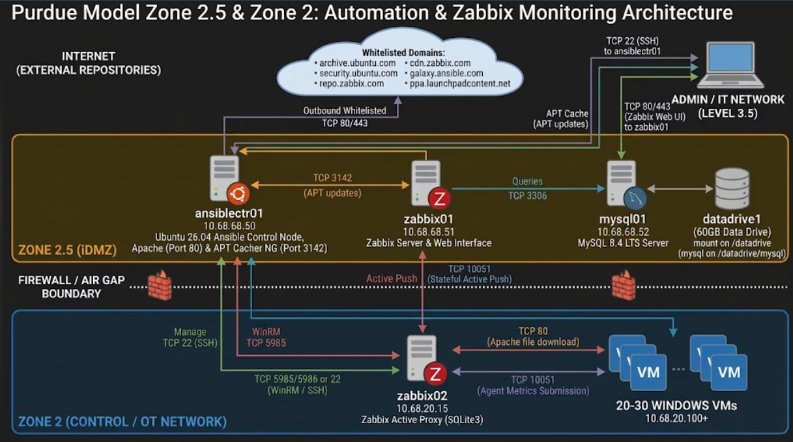

## Ansible

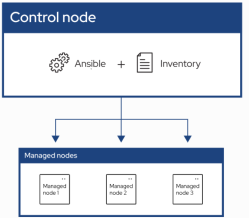

https://docs.ansible.com/projects/ansible/latest/getting_started/index.html


## Vnet and subnet

Zone 1: External access public ip

Subnet 1 (iDMZ / Management) zone 2.5:

Address range: 10.68.68.0/24

Covers: 10.68.68.4 (ansiblectr01), 10.68.68.5 (zabbix01), and ip tbd (mysql01).

Subnet 2 (OT / Target) zone 2.0:

Address range: 10.68.20.0/24

Covers: ip tbd (zabbix02)


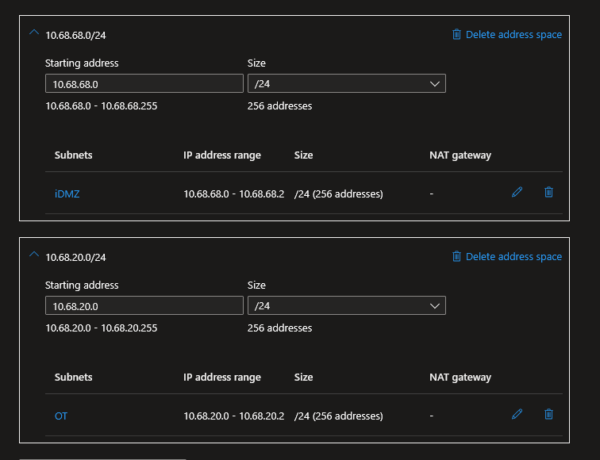

## VM's Azure Retirement of default outbound access: scope and impact

That is correct. Microsoft has shifted default outbound access to restricted/disabled for new virtual machines in Azure.

When a VM does not have explicit outbound connectivity configured—such as through an Azure NAT Gateway, a load balancer with outbound rules, or an explicit public IP with outbound rules configured under the newer security models—it cannot initiate outbound connections to the public internet.

Opening port 8080, 80, and 443 with source "Any" and destination "Any" via a Network Security Group (NSG) rule would bypass your internal caching architecture and expose your nodes directly to the public internet.

Only your controller node (ansiblectr01 at 10.68.68.4) needs direct internet access to pull fresh packages from the public repositories and cache them via apt-cacher-ng.

Adding a public IP address to zabbix01 allows you to access the Zabbix web interface from your browser while keeping outbound internet access blocked via your Network Security Group (NSG) rules.

Yes, exactly. Under Azure's default outbound access policy, assigning a public IP address to a virtual machine (such as zabbix01) does not automatically grant it outbound internet access.

https://learn.microsoft.com/en-us/azure/virtual-network/ip-services/default-outbound-access?tabs=portal

## Virtual machines in Rg-swc-ansiblestack-01

* ansiblectr01, 10.68.68.4, with public ip and allow internet
* azureuser/ ouch no-> imsdal, you know


## Virtual machines in Rg-swc-vms-01

* zabbix01, 10.68.68.5, (with public ip also, but no outbund internet, deny with NSG) later
* mysql01, 10.68.68.52, no outbund internet by default
* zabbix02, 10.68.20.15, no outbund internet by default

## Create ansiblectr01 Subnet 1 (iDMZ / Management)

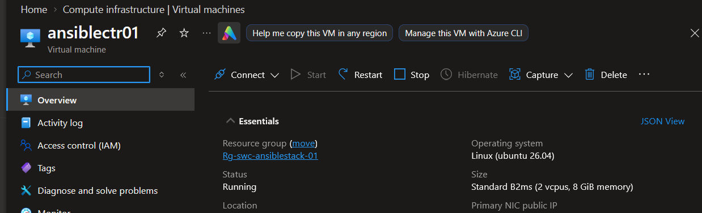

## Install Ansible on ansiblectr01


ansiblectr01 | Network settings Outbund port rule added

Allow_internet

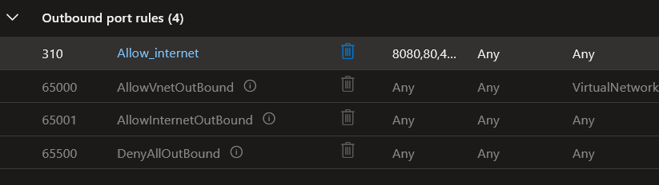

10.68.68.4

```bash

azureuser@ansiblectr01

sudo apt update
sudo apt install software-properties-common
sudo add-apt-repository --yes --update ppa:ansible/ansible
sudo apt install ansible

# install
sudo apt install ansible

# check v
ansible --version
```
Log

```console
ansible [core 2.21.5]
  config file = /etc/ansible/ansible.cfg
  configured module search path = ['/home/azureuser/.ansible/plugins/modules', '/usr/share/ansible/plugins/modules']
  ansible python module location = /usr/lib/python3/dist-packages/ansible
  ansible collection location = /home/azureuser/.ansible/collections:/usr/share/ansible/collections
  executable location = /usr/bin/ansible
  python version = 3.14.4 (main, Aug 20 2026, 10:41:58) [GCC 15.2.0] (/usr/bin/python3)
  jinja version = 3.1.6
  pyyaml version = 6.0.3 (with libyaml v0.2.5)
```

https://docs.ansible.com/projects/ansible/latest/installation_guide/installation_distros.html

### Create folder structure

```bash
mkdir io_ot_lab
cd io_ot_lab
mkdir inventory
cd inventory
touch hosts.ini
cd..
mkdir playbooks
touch ansible.cfg

ls
ansible.cfg  inventory  playbooks
```


## Create zabbix01 Subnet 1 (iDMZ / Management)

10.68.68.5

```bash
# ssh into vm
Last login: Wed Nov 11 18:25:27 2026 from 10.68.68.4
azureuser@zabbix01
```

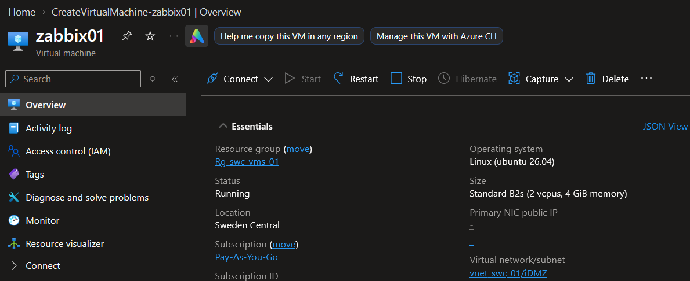

## Populate folder structure and verify ssh

```bash

azureuser@ansiblectr01

cd io_ot_lab/

sudo nano inventory/hosts.ini
```

Configure inventory/hosts.ini

```ini
[ot_nodes]
zabbix01 ansible_host=10.68.68.5 ansible_user=azureuser

[ot_nodes:vars]
ansible_connection=ssh
```

```bash
ansible-inventory -i inventory/hosts.ini --list
```
Verification: Run ansible-inventory -i inventory/hosts.ini --list to ensure Ansible parses the host definition correctly.

```console
azureuser@ansiblectr01:~/io_ot_lab$ ansible-inventory -i inventory/hosts.ini --list
{
    "_meta": {
        "hostvars": {
            "10.68.68.5": {
                "ansible_connection": "ssh",
                "ansible_user": "azureuser"
            }
        },
        "profile": "inventory_legacy"
    },
    "all": {
        "children": [
            "ungrouped",
            "ot_nodes"
        ]
    },
    "ot_nodes": {
        "hosts": [
            "10.68.68.5"
        ]
    }
}
```
Update your root ansible.cfg file to set the default inventory path and disable strict host key checking for lab environments:

```bash
azureuser@ansiblectr01

cd io_ot_lab/

sudo nano ansible.cfg
```

```ini
[defaults]
callbacks_enabled = profile_tasks, timer
inventory = inventory/hosts.ini
host_key_checking = False
retry_files_enabled = False
interpreter_python = auto_silent
```

```bash

#  Verification: Run ansible-config view to confirm the active configuration.
ansible-config

# o view your active ansible.cfg configuration file cleanly, use the view action argument:
ansible-config view

```

### Enable passwordless, secure SSH authentication

To enable passwordless, secure SSH authentication from your Ansible controller node (ansiblectr01, 10.68.68.4) to your target host (10.68.68.5), you need to generate an SSH key pair on the controller and copy the public key to the remote host.

```bash

azureuser@ansiblectr01

ssh-keygen -t rsa -b 4096 -N "" -f ~/.ssh/id_rsa

ls -la ~/.ssh/id_rsa.pub

# Copy Public Key to Target Node
ssh-copy-id -i ~/.ssh/id_rsa.pub azureuser@10.68.68.5

# ssh login with key no pass
ssh azureuser@10.68.68.5

sudo mkdir -p /opt/ansible
sudo chown -R azureuser:azureuser /opt/ansible
```

Lets update the ansible.cfg and add a log path also

```ini
# Version: 1.1.0
# Description: Global Ansible configuration with password-prompted privilege escalation for lab automation.

[defaults]
inventory = ./inventory/hosts.ini
remote_user = azureuser
private_key_file = ~/.ssh/id_rsa
host_key_checking = False
retry_files_enabled = False
stdout_callback = default
log_path = /opt/ansible/automation.log

[privilege_escalation]
become = True
become_method = sudo
become_user = root
become_ask_pass = False
```

## Playbook linux ping_hosts.yml


```bash
azureuser@ansiblectr01

cd io_ot_lab/

sudo nano playbooks/ping_hosts.yml

```

ping_hosts.yml

```yml
---
# Version: 1.0.1
# Description: Ping validation playbook with privilege escalation explicitly disabled

- name: Verify Connectivity Across Purdue Lab Nodes
  hosts: ot_nodes
  gather_facts: false
  become: false
  tasks:
    - name: Ping all inventory hosts
      ansible.builtin.ping:
```


Run it

```bash
ansible-playbook -i inventory/hosts.ini playbooks/ping_hosts.yml
```
log

```console
PLAY [Verify Connectivity Across Purdue Lab Nodes] ******************************************

TASK [Ping all inventory hosts] *************************************************************
[...]
ok: [10.68.68.5]

PLAY RECAP **********************************************************************************
10.68.68.5                 : ok=1    changed=0    unreachable=0    failed=0    skipped=0    rescued=0    ignored=0


```

## Set up apt-cacher-ng and Apache on ansiblectr01


```bash
sudo apt update
sudo apt install -y apt-cacher-ng apache2


```
Allow HTTP tunnels through Apt-Cacher NG? Yes


### Allowed remote repositories

```bash

# Backup the existing configuration file
sudo cp /etc/apt-cacher-ng/acng.conf /etc/apt-cacher-ng/acng.conf.bak

# check what we have first
sudo grep -E "PassThroughPattern|Remap-(ubuntu|ppa|ansible|zabbix)" /etc/apt-cacher-ng/acng.conf

# The grep results show that PassThroughPattern is currently commented out or set to specific defaults, and none of your custom Remap rules are present yet.

# You can safely add your whitelisted repositories and update the PassThroughPattern to allow secure connections.

# Run the following command block to append your repository remapping rules to /etc/apt-cacher-ng/acng.conf:
sudo bash -c 'cat << '\''EOF'\'' >> /etc/apt-cacher-ng/acng.conf

# Ubuntu official mirrors and security updates
Remap-ubuntu: ubuntu.com archive.ubuntu.com security.ubuntu.com ; security.ubuntu.com/ubuntu

# Zabbix official repository
Remap-zabbix: repo.zabbix.com ; repo.zabbix.com/
EOF'

sudo tail -n 15 /etc/apt-cacher-ng/acng.conf

# Append the PassThroughPattern rule to allow secure APT traffic handling:
sudo bash -c 'echo "PassThroughPattern: .*" >> /etc/apt-cacher-ng/acng.conf'

sudo systemctl restart apt-cacher-ng

sudo systemctl status apt-cacher-ng
```


## Playbook linux configure_apt_proxy.yml


```bash
azureuser@ansiblectr01

cd io_ot_lab

sudo nano playbooks/cofigure_apt_proxy.yml


```
configure_apt_proxy.yml

```yml
---
# Version: 1.0.3
# Description: Configures APT HTTP and HTTPS proxy settings for internal caching across nodes.

- name: Configure Internal APT Caching Proxy
  hosts: ot_nodes
  become: true
  tasks:
    - name: Set APT Proxy configuration file
      ansible.builtin.copy:
        dest: /etc/apt/apt.conf.d/01proxy
        content: |
          Acquire::http::Proxy "http://10.68.68.4:3142/ubuntu/";
          Acquire::https::Proxy "http://10.68.68.4:3142/ubuntu/";
        owner: root
        group: root
        mode: '0644'

```

Run it

```bash
azureuser@ansiblectr01

cd io_ot_lab

ansible-playbook -i inventory/hosts.ini playbooks/configure_apt_proxy.yml --check


```

Log

```console
PLAY [Configure Internal APT Caching Proxy] *************************************************

TASK [Gathering Facts] *********************************************************************
[...]

ok: [10.68.68.5]

TASK [Set APT Proxy configuration file] *****************************************************
changed: [10.68.68.5]

PLAY RECAP **********************************************************************************
10.68.68.5                 : ok=2    changed=1    unreachable=0    failed=0    skipped=0    rescued=0    ignored=0
```

The dry-run check mode completed successfully (changed=1, failed=0), confirming that Ansible can connect to your managed node and properly deploy the APT proxy configuration file.


Run it and apply it

```bash
azureuser@ansiblectr01

cd io_ot_lab

# ansible-playbook -i inventory/hosts.ini playbooks/configure_apt_proxy.yml --limit ot_nodes
# or
ansible-playbook -i inventory/hosts.ini playbooks/configure_apt_proxy.yml --limit zabbix01

```

log

```console
PLAY [Configure Internal APT Caching Proxy] *************************************************

TASK [Gathering Facts] **********************************************************************

[...]
TASK [Set APT Proxy configuration file] *****************************************************
changed: [zabbix01]

PLAY RECAP **********************************************************************************
zabbix01                   : ok=2    changed=1    unreachable=0    failed=0    skipped=0    rescued=0    ignored=0
```
### Veriy manual update on zabbix01


```bash
ssh azureuser@10.68.68.5

sudo apt update

sudo apt upgrade

```

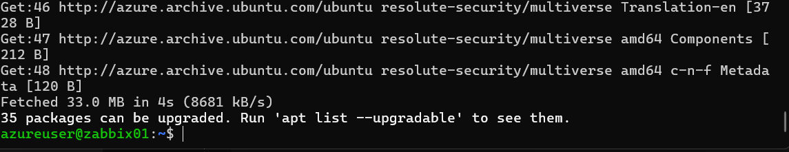

Stop the apt cacher ng and verify no updates possible on zabbix01

```bash
azureuser@ansiblectr01

sudo systemctl stop apt-cacher-ng

ssh azureuser@10.68.68.5
```

No updates

The Connection refused error on port 3142 confirms that zabbix01 is actively trying to route its package updates through your controller's proxy, but the proxy service is currently stopped or unreachable.

Yes, exactly. The connection refusal error when the proxy service was stopped—followed by the successful package fetch once started—proves that zabbix01 relies entirely on your internal proxy (ansiblectr01 at 10.68.68.4:3142) for package updates.

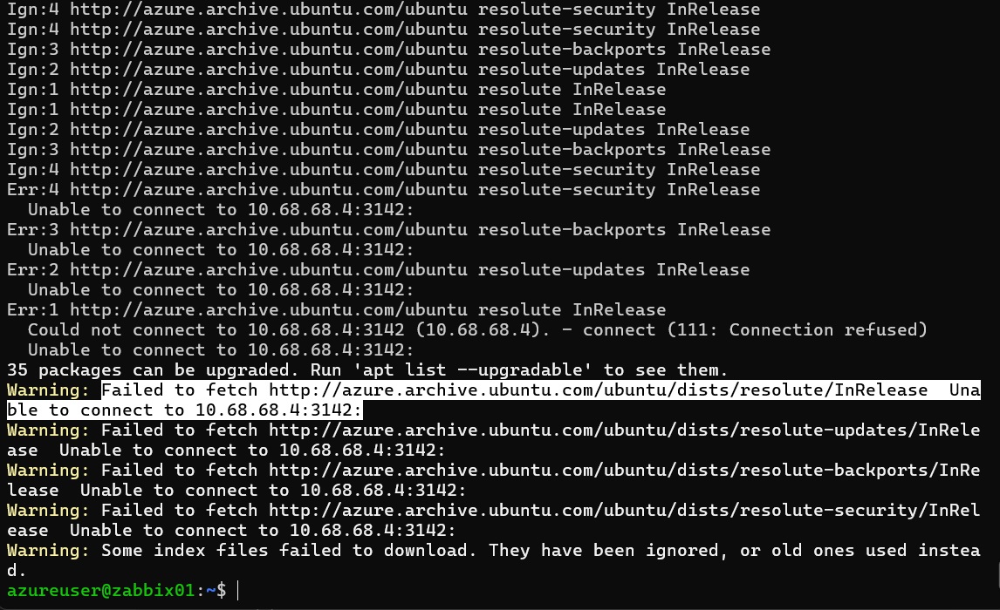


## Playbook linux update_apt.yml with callbacks_enabled = profile_tasks, timer

```bash
azureuser@ansiblectr01:~/io_ot_lab
sudo nano playbooks/update_apt.yml

```

update_apt.yml

```yml
---
# Version: 1.0.0
# Description: Updates package cache and safely upgrades system packages across managed nodes using the APT proxy.

- name: Update and Upgrade System Packages
  hosts: ot_nodes
  become: true
  tasks:
    - name: Update apt repository cache
      ansible.builtin.apt:
        update_cache: true
        cache_valid_time: 3600

    - name: Perform a safe upgrade of installed packages
      ansible.builtin.apt:
        upgrade: safe
```
run it

```bash
ansiblectr01

cd io_ot_lab/

ansible-playbook -i inventory/hosts.ini playbooks/update_apt.yml --limit zabbix01 --check

# if the play is ok, remove --check with --diff and or --limit
ansible-playbook -i inventory/hosts.ini playbooks/update_apt.yml --limit zabbix01

```

log

```console
PLAY [Update and Upgrade System Packages] ***************************************************

TASK [Gathering Facts] **********************************************************************
Wednesday 11 November 2026  20:04:56 +0000 (0:00:00.014)       0:00:00.014 ****
ok: [zabbix01]

TASK [Update apt repository cache] **********************************************************
Wednesday 11 November 2026  20:04:58 +0000 (0:00:01.995)       0:00:02.010 ****
ok: [zabbix01]

TASK [Perform a safe upgrade of installed packages] *****************************************
Wednesday 11 November 2026  20:04:59 +0000 (0:00:00.897)       0:00:02.907 ****
ok: [zabbix01]

PLAY RECAP **********************************************************************************
zabbix01                   : ok=3    changed=0    unreachable=0    failed=0    skipped=0    rescued=0    ignored=0


TASKS RECAP *********************************************************************************
Wednesday 11 November 2026  20:05:00 +0000 (0:00:01.239)       0:00:04.147 ****
===============================================================================
Gathering Facts ---------------------------------------------------------------------- 2.00s
Perform a safe upgrade of installed packages ----------------------------------------- 1.24s
Update apt repository cache ---------------------------------------------------------- 0.90s

PLAYBOOK RECAP ******************************************************************************
Playbook run took 0 days, 0 hours, 0 minutes, 4 seconds
```

Now we have more output for time and date and more.


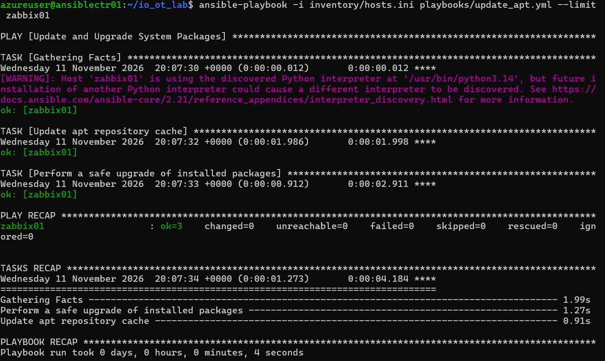


## Current vms

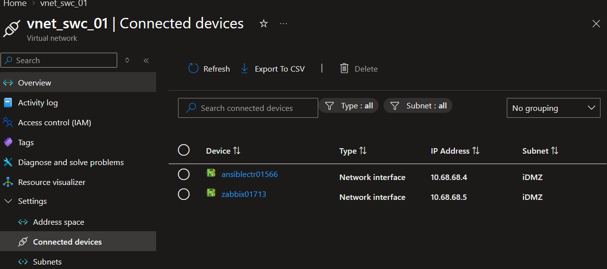


## Install Semaphore UI on ansiblectr01

### We could do it with Ansible playbook also/ this is manual install to get to know it

To install Ansible Semaphore (a modern UI for Ansible) on your ansiblectr01 node, you can run Semaphore as a systemd service backed by a database (such as SQLite, which is lightweight and ideal for standalone controller nodes).

```bash
ansiblectr01

wget https://github.com/semaphoreui/semaphore/releases/download/v2.17.15/semaphore_2.17.15_linux_amd64.deb

ls -la semaphore_2.17.15_linux_amd64.deb
-rw-rw-r-- 1 azureuser azureuser 18833690 Feb 27  2026 semaphore_2.17.15_linux_amd64.deb

# Install the downloaded Debian package using dpkg:
sudo dpkg -i semaphore_2.17.15_linux_amd64.deb

# 
semaphore setup

```
1. Follow the interactive prompts to define your database settings, administrator account, and HTTP port.
Verification: Check that your configuration file (or database) has been created successfully in the directory specified during setup.

```txt

Sqlite

Configuration path: Press Enter to accept the default or specify /etc/semaphore/config.json.

Database dialect: Choose sqlite3.

Path to SQLite database: Specify /home/azureuser/io_ot_lab/semaphore.db

Path to Playbooks: Point this directly to your lab directory (/home/azureuser/io_ot_lab/playbooks).

Admin account details: Enter your desired username, email, and password for accessing the web UI.
```

2. Configure SQLite and Paths

Review your generated configuration file (for example, in your project folder or /etc/semaphore/config.json) to confirm that the SQLite database path and your Ansible playbook directories are correctly mapped:


```bash
ansiblectr01

ls
ansible.cfg  config.json  inventory  playbooks  semaphore.db

# check you config
cat config.json
```
Your config.json is missing the playbook_path and port keys required for Semaphore to locate your playbooks and serve the web interface. Update your config.json file to include them.

```bash
sudo nano config.json

```
Added

```json
"playbook_path": "/home/azureuser/io_ot_lab/playbooks",
        "port": "3000",
```
Rerun validation

```bash
semaphore setup --config /home/azureuser/io_ot_lab/config.json

# check all steps


```

Create service file

```bash
# Create the Systemd Service File
sudo nano /etc/systemd/system/semaphore.service
```

file

```ini
[Unit]
Description=Semaphore UI Ansible Automation Server
After=network.target

[Service]
User=azureuser
WorkingDirectory=/home/azureuser/io_ot_lab
ExecStart=/usr/bin/semaphore server --config /home/azureuser/io_ot_lab/config.json
Restart=always
RestartSec=5

[Install]
WantedBy=multi-user.target
```
Reload it

```bash
# Reload systemd to recognize or update the service configuration, then start and enable Semaphore:
sudo systemctl daemon-reload
sudo systemctl enable --now semaphore.service

sudo systemctl status semaphore.service
● semaphore.service - Semaphore UI Ansible Automation Server
     Loaded: loaded (/etc/systemd/system/semaphore.service; enabled; preset: enabled)
     Active: active (running) since Wed 2026-11-11 20:27:17 UTC; 9s ago
```

### Accessing Semaphore UI


Add allow in semaphore 3000 tcp, NSG.


https://semaphoreui.com/docs/admin-guide/installation/package-manager


https://semaphoreui.com/


URL: [http://10.68.68.4:3000](http://10.68.68.4:3000) (or via your controller's accessible IP/port)


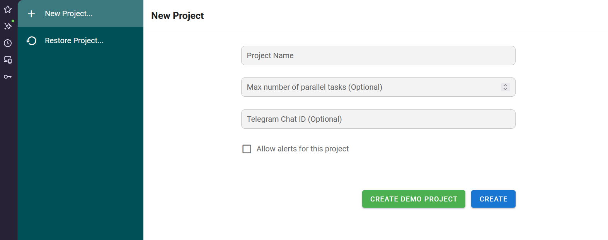

### SSL/TLS Certificates


```bash
sudo openssl req -x509 -nodes -days 3650 -newkey rsa:2048 \
  -keyout /home/azureuser/io_ot_lab/semaphore.key \
  -out /home/azureuser/io_ot_lab/semaphore.crt \
  -subj "/CN=10.68.68.4"

sudo chown azureuser:azureuser /home/azureuser/io_ot_lab/semaphore.key /home/azureuser/io_ot_lab/semaphore.crt
chmod 600 /home/azureuser/io_ot_lab/semaphore.key

sudo nano config.json
```

Update your /home/azureuser/io_ot_lab/config.json to include the certificate and key paths:

```json
"tls_cert": "/home/azureuser/io_ot_lab/semaphore.crt",
        "tls_key": "/home/azureuser/io_ot_lab/semaphore.key",
```

```bash
sudo systemctl restart semaphore.service
sudo systemctl status semaphore.service
```


Enable service

```bash
sudo nano /etc/systemd/system/semaphore.service
```

```ini

[Unit]
[Unit]
Description=Semaphore UI Ansible Automation Server
After=network.target

[Service]
User=azureuser
WorkingDirectory=/home/azureuser/io_ot_lab
ExecStart=/usr/bin/semaphore server --config /home/azureuser/io_ot_lab/config.json
Restart=always
RestartSec=5

[Install]
WantedBy=multi-user.target

```

```bash
sudo systemctl daemon-reload
sudo systemctl restart semaphore.service

 sudo systemctl status semaphore.service
● semaphore.service - Semaphore UI Ansible Automation Server
     Loaded: loaded (/etc/systemd/system/semaphore.service; enabled; preset: enabled)
     Active: active (running) since Wed 2026-11-11 20:42:22 UTC; 1min 23s ago
```

###  Apache in front of Semaphore for secure HTTPS access


```bash
 sudo systemctl status apache2.service
● apache2.service - The Apache HTTP Server
     Loaded: loaded (/usr/lib/systemd/system/apache2.service; enabled; preset: enabled)
     Active: active (running) since Wed 2026-11-11 19:09:00 UTC; 1h 50min ago

# Enable Apache's proxy, proxy_http, ssl, and rewrite modules required for handling reverse proxying and SSL termination:
sudo a2enmod proxy proxy_http ssl rewrite headers

sudo nano /etc/apache2/sites-available/semaphore.conf
```

Use public ip not x.xxx.xx.x
```txt
<VirtualHost *:443>
    ServerName x.xx.xx.x

    SSLEngine on
    SSLCertificateFile /home/azureuser/io_ot_lab/semaphore.crt
    SSLCertificateKeyFile /home/azureuser/io_ot_lab/semaphore.key

    ProxyPreserveHost On
    ProxyRequests Off

    # Proxy traffic to Semaphore running on plain HTTP port 3000
    ProxyPass / http://127.0.0.1:3000/
    ProxyPassReverse / http://127.0.0.1:3000/

    # WebSocket support for live playbook logs
    RewriteEngine On
    RewriteCond %{HTTP:Upgrade} =websocket [NC]
    RewriteRule /(.*)  ws://127.0.0.1:3000/$1 [P,L]
    RewriteCond %{HTTP:Upgrade} !=websocket [NC]
    RewriteRule /(.*)  http://127.0.0.1:3000/$1 [P,L]

    ErrorLog ${APACHE_LOG_DIR}/semaphore_error.log
    CustomLog ${APACHE_LOG_DIR}/semaphore_access.log combined
</VirtualHost>
```
Enable the Apache Site and Restart Service

```bash
sudo a2ensite semaphore.conf
sudo a2dissite 000-default.conf
sudo apache2ctl configtest
sudo systemctl restart apache2

# Verification: The config test returns Syntax OK, and sudo systemctl status apache2 shows active (running).
sudo systemctl status apache2.service
● apache2.service - The Apache HTTP Server
     Loaded: loaded (/usr/lib/systemd/system/apache2.service; enabled; preset: enabled)
     Active: active (running) since Wed 2026-11-11 21:01:03 UTC; 24s ago
```

Check your Inbound port rules to ensure there is a rule allowing TCP traffic on Port 443 from any source (or your client IP) to any destination.
Verification: If port 443 is missing, click Add inbound port rule, set destination port ranges to 443, protocol to TCP, action to Allow, and save.


Validity
Not Before
Wed, 11 Nov 2026 20:33:20 GMT
Not After
Sat, 08 Nov 2036 20:33:20 GMT 


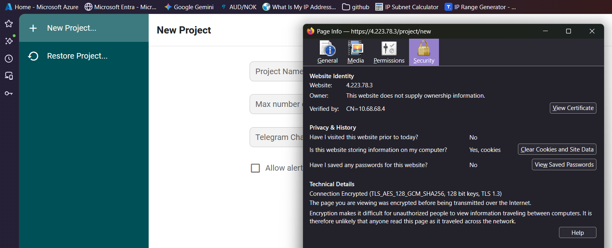

now that Apache is handling SSL termination on port 443 and securely proxying traffic to Semaphore locally, you should clean up and close port 3000 in your Azure Network Security Group (NSG) so external traffic is forced through the secure HTTPS proxy.

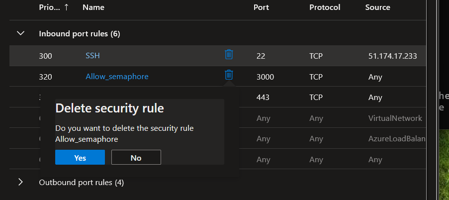


## Setup Ansible ansiblectr01 with Semaphore

* Playbooks live locally: You write, edit, and store your .yml playbook files directly in your local directory on the controller node (/home/azureuser/io_ot_lab/playbooks/).
* Semaphore links to them: Semaphore reads those local files (or your connected Git repository) and provides the buttons, access keys, inventory mappings, and web triggers to execute them.

Next Steps in the Web Interface

Log into Semaphore, click New Project, enter IO-OT Lab as the project name, and click Create.
Verification: You are redirected to the new project dashboard view.

🔵 Add Repository: Point Semaphore to your local playbook directory or a Git repository if applicable.

🔵 Add Inventory: Define your inventory path (inventory/hosts.ini).

🔵 Add Environment / Access Keys: Configure your SSH private key so Semaphore can authenticate against your managed nodes (zabbix01, mysql01, zabbix02).

🔵 Create Templates: Link your playbooks (configure_apt_proxy.yml, update_apt.yml) to templates for easy execution directly from the dashboard

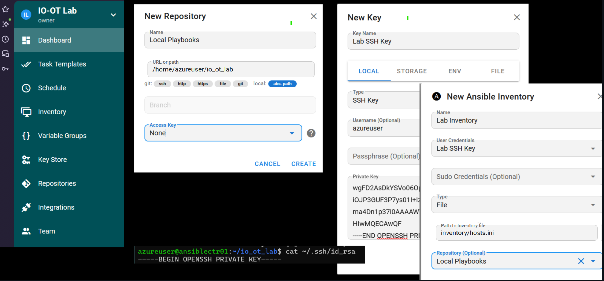


## Playbooks linux Semaphore run

What to Do Next

To start running your automation tasks, you can proceed with creating your execution templates:

* Create Templates: Go to Templates in your Semaphore dashboard and link your playbooks (ping_hosts.yml, update_apt.yml, configure_apt_proxy.yml) to your Lab Inventory and Lab SSH Key.

* Run and Test: Trigger a run directly from the dashboard to verify that Semaphore successfully executes your playbooks against your lab nodes over SSH.


### linux ping_hosts.yml

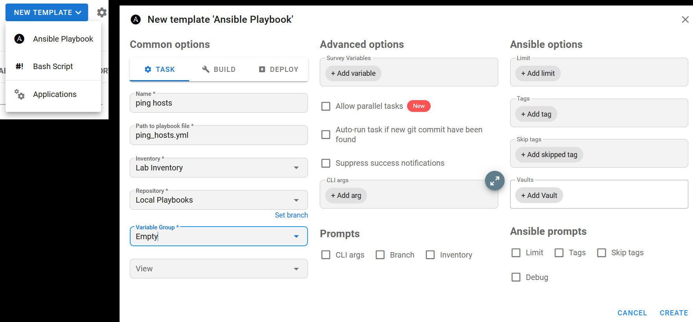

Run the playbook

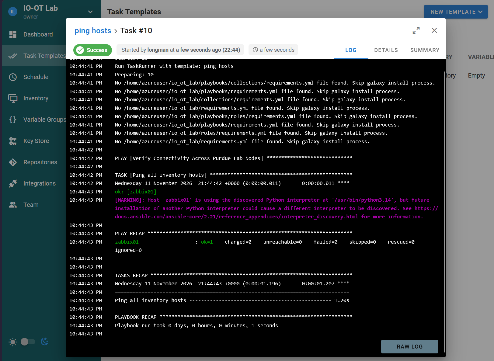

Verify in Semaphore

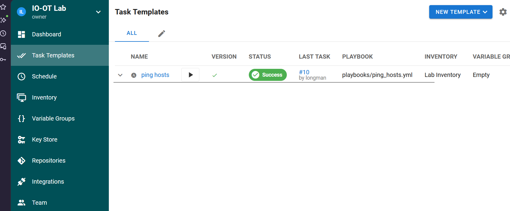

### linux update_apt.yml

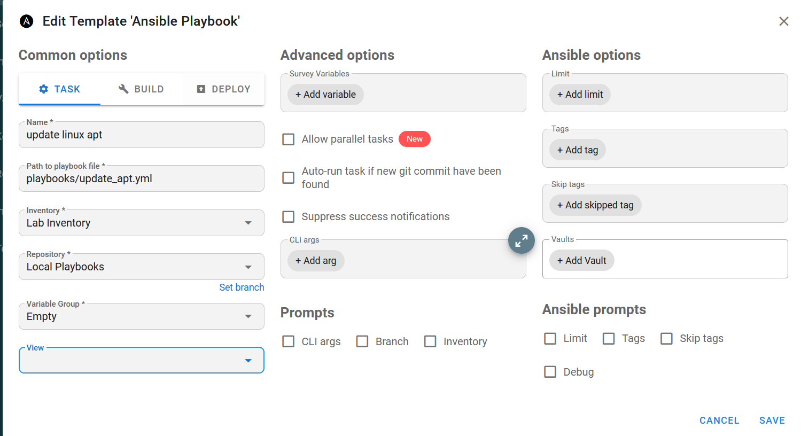

Success, we updated zabbix01


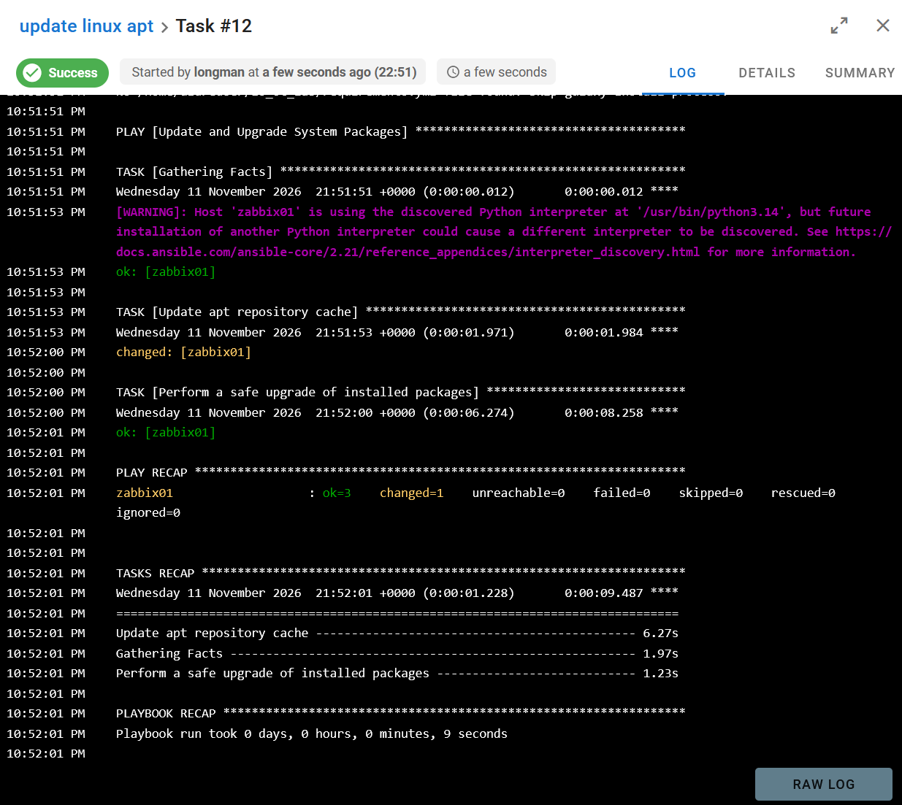


Success


Status for playbooks

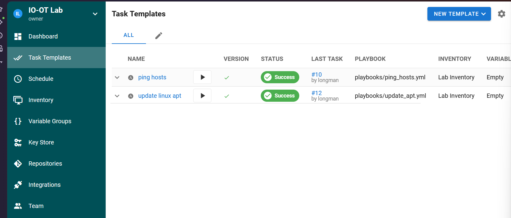


## Topology at this stage

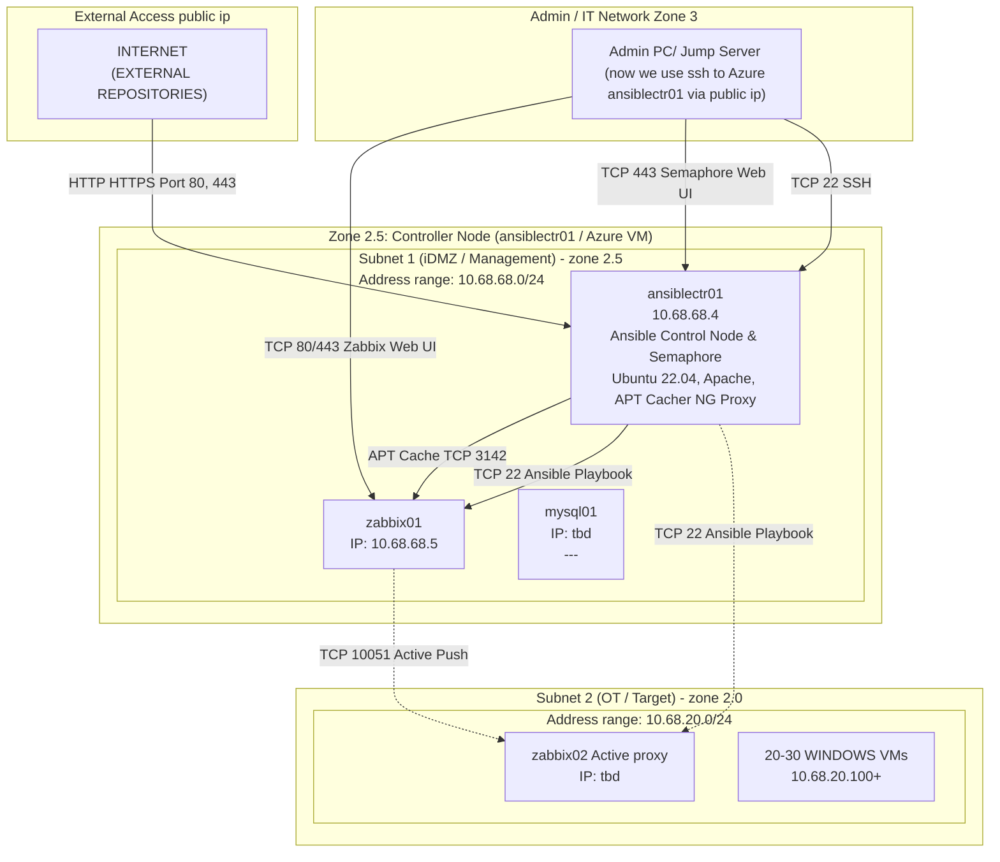

This is the final set up (ip may change but the concept is the same)


# Set up the rest of the stack

## Create mysql01 and zabbix02

* Create mysql01 and add a extra datadisk with 32 GB


Vm mysql01 created 10.68.68.6

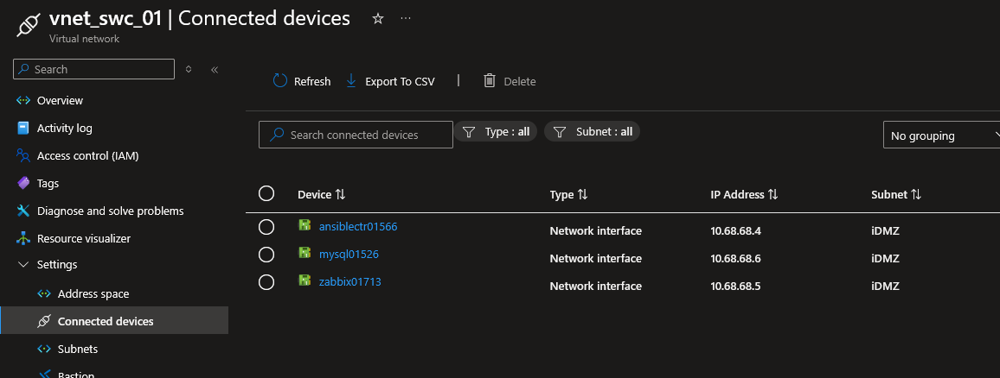

* Create zabbix02

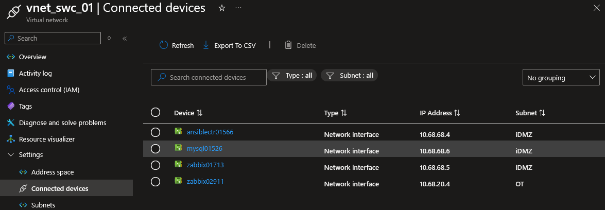

## Structure inventory/hosts.ini and align all configurations

```ini
[idmz_nodes]
zabbix01 ansible_host=10.68.68.5 ansible_user=azureuser  ansible_python_interpreter=/usr/bin/python3.14
mysql01 ansible_host=10.68.68.6 ansible_user=azureuser  ansible_python_interpreter=/usr/bin/python3.14

[ot_nodes]
zabbix02 ansible_host=10.68.20.4 ansible_user=azureuser

[idmz_nodes:vars]
ansible_connection=ssh

[ot_nodes:vars]
ansible_connection=ssh

[all:vars]
ansible_python_interpreter=auto_silent


```

### Add ssh keys for new hosts

```bash

# Copy SSH Public Key to mysql01
ssh-copy-id -i ~/.ssh/id_rsa.pub azureuser@10.68.68.6

ssh azureuser@10.68.68.6

# Copy SSH Public Key to zabbix02
ssh-copy-id -i ~/.ssh/id_rsa.pub azureuser@10.68.20.4

ssh azureuser@10.68.20.4
```

## Playbook linux ping_hosts.yml update hosts

hosts: ot_nodes

Update

hosts: ot_nodes:idmz_nodes
```yml
---
# Version: 1.0.1
# Description: Ping validation playbook with privilege escalation explicitly disabled

- name: Verify Connectivity Across Purdue Lab Nodes
  hosts: ot_nodes:idmz_nodes
```

Run it

```bash
azureuser@ansiblectr01:~/io_ot_lab

ansible-playbook -i inventory/hosts.ini playbooks/ping_hosts.yml
```

log

```console
PLAY [Verify Connectivity Across Purdue Lab Nodes] *********************************************************************

TASK [Ping all inventory hosts] ****************************************************************************************
Thursday 12 November 2026  08:51:31 +0000 (0:00:00.011)       0:00:00.011 *****
ok: [mysql01]
ok: [zabbix01]
ok: [zabbix02]

PLAY RECAP *************************************************************************************************************
mysql01                    : ok=1    changed=0    unreachable=0    failed=0    skipped=0    rescued=0    ignored=0
zabbix01                   : ok=1    changed=0    unreachable=0    failed=0    skipped=0    rescued=0    ignored=0
zabbix02                   : ok=1    changed=0    unreachable=0    failed=0    skipped=0    rescued=0    ignored=0


TASKS RECAP ************************************************************************************************************
Thursday 12 November 2026  08:51:32 +0000 (0:00:01.167)       0:00:01.178 *****
===============================================================================
Ping all inventory hosts ---------------------------------------------------------------------------------------- 1.17s

PLAYBOOK RECAP *********************************************************************************************************
Playbook run took 0 days, 0 hours, 0 minutes, 1 seconds
```

## Run linux ping_hosts.yml Semaphore

It automatically picks up all our new hosts.


## Playbook Configure a Dedicated Template per Host/Group (Recommended) in Semaphore

```bash
# ansible we can run
azureuser@ansiblectr01:~/io_ot_lab

# all vms
ansible-playbook -i inventory/hosts.ini playbooks/configure_apt_proxy.yml

# just one
ansible-playbook -i inventory/hosts.ini playbooks/configure_apt_proxy.yml --limit zabbix01
```
In Semaphore, templates are designed to be reusable workflows. Rather than manually typing --limit every time, the cleanest approach is to create distinct templates mapped to specific inventory groups or hosts:

1. Go to Templates and click New Template.

2. Name it something descriptive, such as Update APT - zabbix01 only.

3. Select your playbook (playbooks/update_apt.yml).

4. Select your Inventory (hosts.ini).

5. In the Limit field provided by Semaphore's template settings, enter your specific host or group name (e.g., zabbix01 or ot_nodes).

6. Click Save.

Verification: Launching this template automatically applies the limit without requiring manual command-line flags.


# Playbooks with Ansible

## Playbook linux verify_isolation.yml only ansiblectr01 has outbound internet

```bash
azureuser@ansiblectr01:~/io_ot_lab

cd io_ot_lab/

# if the play is ok, remove --check with --diff and or --limit

# Version: 1.2.0
# Description: Verifies network isolation by checking if managed nodes can reach www.google.com.
ansible-playbook -i inventory/hosts.ini playbooks/verify_isolation.ym

```

log
```console
PLAY [Verify Internet Isolation on Managed Nodes] **********************************************************************

TASK [Attempt connection to public internet destination] ***************************************************************
Thursday 12 November 2026  07:32:04 +0000 (0:00:00.045)       0:00:00.045 *****
ok: [zabbix01]

TASK [Assert that external internet connection failed] *****************************************************************
Thursday 12 November 2026  07:32:47 +0000 (0:00:42.245)       0:00:42.291 *****
ok: [zabbix01] => {
    "changed": false,
    "msg": "Isolation verified: Host cannot reach the public internet directly."
}

PLAY RECAP *************************************************************************************************************
zabbix01                   : ok=2    changed=0    unreachable=0    failed=0    skipped=0    rescued=0    ignored=0


TASKS RECAP ************************************************************************************************************
Thursday 12 November 2026  07:32:47 +0000 (0:00:00.064)       0:00:42.355 *****
===============================================================================
Attempt connection to public internet destination -------------------------------------------------------------- 42.25s
Assert that external internet connection failed ----------------------------------------------------------------- 0.06s

PLAYBOOK RECAP *********************************************************************************************************
```

Success

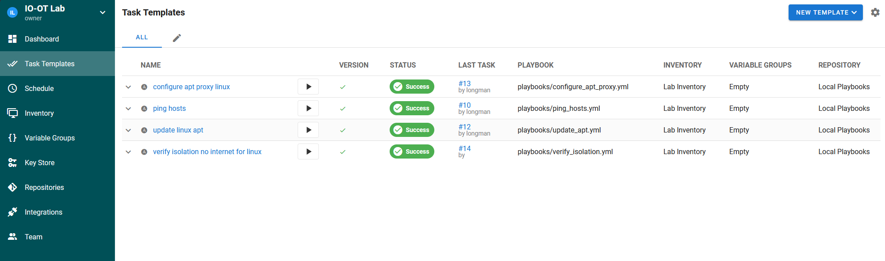

## Playbook linux mount_datadrive_check.yml --check --limit

```bash
azureuser@ansiblectr01:~/io_ot_lab

cd io_ot_lab/

# if the play is ok, remove --check with --diff and or --limit

# Version: 1.2.0
# Description: Verifies network isolation by checking if managed nodes can reach www.google.com.
ansible-playbook -i inventory/hosts.ini playbooks/verify_isolation.ym

```

## Playbook linux mount_datadrive.yml


```bash
azureuser@ansiblectr01:~/io_ot_lab

cd io_ot_lab/

# if the play is ok, remove --check with --diff and or --limit

# Version: 1.2.0
# Description: Verifies network isolation by checking if managed nodes can reach www.google.com.
ansible-playbook -i inventory/hosts.ini playbooks/verify_isolation.ym

```

# Create a Windows host

## Playbook windows tbd


